# Báo cáo EDA: Grupo Bimbo

Khám phá dữ liệu theo 8 bước trên toàn bộ 74,180,464 dòng giao hàng (tuần 3–9). Các con số đều tính lại được bằng 2 lệnh:

```bash
docker compose exec -T spark-master /opt/spark/bin/spark-submit /opt/pipeline/spark_jobs/eda.py
```
```bash
python notebooks/eda_report.py
```

- `spark_jobs/eda.py` chỉ đọc bronze, silver, gold rồi ghi kết quả vào `logs/eda/`. Job này không nằm trong `run.sh`, nên pipeline không thay đổi. Log chạy: `logs/evidence/eda_run_20261104.log`.
- `notebooks/eda_report.py` vẽ biểu đồ vào `docs/eda/figures/` và ghi mọi con số vào `docs/eda/eda_summary.json`.
- **Chính xác hay lấy mẫu:** các thống kê, value count, cube theo tuần × kênh × bang × brand và Pearson đều tính trên toàn bộ dữ liệu. Lấy mẫu chỉ ở những chỗ ghi rõ: Spearman và scatter (0.5% dòng), PCA/t-SNE (10% khách), tự tương quan và trùng khóa (2% khách). Mẫu có `seed` hoặc chọn theo `Cliente_ID` nên lần chạy nào cũng ra cùng kết quả.

## Tóm tắt kết quả

| # | Phát hiện | Số liệu | Việc nên làm |
|---|---|---|---|
| 1 | Hàng trả "tăng 27.6%" chủ yếu do **một dòng** | Bỏ dòng 250,000 đơn vị: còn +8.2%; theo giá trị: +3.6% | Đọc lại kết luận Q1 (slide kết quả Q1) |
| 2 | Dữ liệu đầy đủ, không thiếu giá trị | 0 null ở cả 5 bảng; không trùng khóa trên mẫu 1.47 triệu dòng | Không cần xử lý missing |
| 3 | Nhu cầu lệch phải rất mạnh | Trung vị 3, trung bình 7.22, skew 43 | Dùng log khi vẽ và khi làm mô hình |
| 4 | Mỗi kênh là một phân phối riêng | Trung vị kênh 1 = 3, kênh 2 = 30, kênh 5 = 103 | Phân tích và đặt ngưỡng theo từng kênh |
| 5 | Ngưỡng outlier chung không công bằng | Kênh 5 bị gắn cờ 13.19% số dòng, kênh 1 chỉ 0.01% | Đã làm: `is_outlier_channel` trong silver |
| 6 | Doanh thu rất tập trung | 1% khách = 33.2% doanh thu; 10% sản phẩm = 81.2% | Ưu tiên theo nhóm lớn |
| 7 | Nhu cầu của một chuỗi khá ổn định, nhưng chuỗi rất thưa | Tương quan ~0.79; 36.4% chuỗi chỉ có 1 tuần | Đã làm: `spark_jobs/forecast.py` |
| 8 | Phân khúc Q4 không phải cụm tự nhiên | Silhouette theo quy tắc Q4 ≈ 0.016; KMeans k=2 ≈ 0.41 | Xem Q4 là cách chia theo nghiệp vụ |

---

## Bước 1. Hiểu dữ liệu

| Bảng | Số dòng | Số cột | Giá trị null |
|---|---:|---:|---:|
| `train` | 74,180,464 | 11 | 0 |
| `test` | 6,999,251 | 7 | 0 |
| `cliente_tabla` | 935,362 | 2 | 0 |
| `producto_tabla` | 2,592 | 2 | 0 |
| `town_state` | 790 | 3 | 0 |

Số giá trị khác nhau trong `train`: 7 tuần, 552 agency, 9 kênh, 3,603 tuyến, 880,604 khách, 1,799 sản phẩm.

**Nhận xét:**
- **Không thiếu dữ liệu.** Lý do có thể là dữ liệu đã được Kaggle làm sạch trước khi công bố, nên đừng hiểu là hệ thống gốc của Bimbo không có lỗi.
- **Không trùng khóa.** Tổ hợp tuần × agency × kênh × tuyến × khách × sản phẩm là duy nhất trên mẫu 1,473,284 dòng (2% khách). Mỗi dòng đúng là một lần giao, nên cộng dồn không bị tính trùng.
- **Danh mục lớn hơn dữ liệu dùng thật.** Danh mục có 2,592 sản phẩm nhưng chỉ 1,799 sản phẩm có giao dịch. Có 930,500 mã khách nhưng chỉ 880,604 khách có giao dịch. Vì vậy nên tính số khách từ bảng fact, không tính từ danh mục.

## Bước 2. Thống kê mô tả

| Chỉ số | Bán (đơn vị) | Trả (đơn vị) | Nhu cầu (đơn vị) |
|---|---:|---:|---:|
| Mean | 7.31 | 0.13 | 7.22 |
| Median | 3 | 0 | 3 |
| Q1 – Q3 | 2 – 7 | 0 – 0 | 2 – 6 |
| Std | 21.97 | 29.32 | 21.77 |
| Min – Max | 0 – 7,200 | 0 – 250,000 | 0 – 5,000 |
| Skewness | 43.0 | 8,358.9 | 43.0 |
| Kurtosis (dư) | 4,848 | 71,225,694 | 4,790 |

**Cách đọc và ý nghĩa:**
- **Mean gấp hơn 2 lần median** (7.22 so với 3): vài dòng rất lớn đã kéo trung bình lên. Khi nói về "một dòng điển hình", nên dùng trung vị.
- **Std gấp 3 lần mean:** dữ liệu phân tán rất mạnh, các phép tính dựa trên mean và std cần được dùng cẩn thận.
- **Skewness:** phân phối chuẩn có skew = 0, ở đây là 43, tức có đuôi dài về bên phải.
- **Kurtosis của hàng trả lên tới 71 triệu:** đây là dấu hiệu cho thấy có giá trị cực đoan. Chính con số này đã dẫn tới việc tìm ra dòng 250,000 đơn vị ở bước 6.
- **96.57% dòng không có hàng trả.** Hàng trả là biến gần như toàn 0, kèm một đuôi rất dài.

## Bước 3. Phân phối dữ liệu

### Histogram: `03_hist_demand.png`
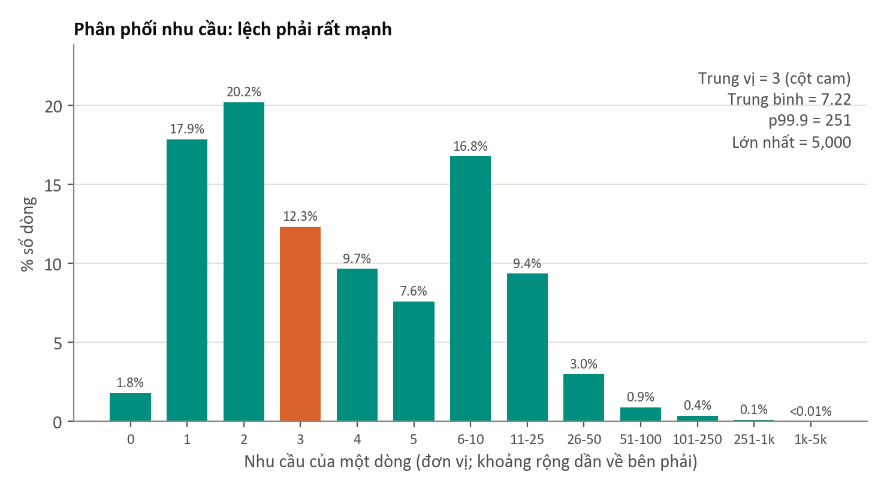

- **Chart này là gì:** tỷ lệ % số dòng theo từng mức nhu cầu. Từ 0 đến 5 mỗi cột là một giá trị, sau đó khoảng rộng dần để nhìn được cả phần đuôi dài. Vì vậy, chiều cao giữa các cột có khoảng khác nhau không so sánh trực tiếp được.
- **Cách đọc:** giá trị phổ biến nhất là 2 đơn vị (20.2% số dòng), tiếp theo là 1 đơn vị (17.9%). Cột cam chứa trung vị.
- **Phát hiện:** 75% số dòng có nhu cầu từ 6 trở xuống, nhưng đuôi kéo dài tới 5,000.
- **Ý nghĩa:** nên dùng `log(1 + nhu cầu)` khi làm mô hình, và tính đến sai số tương đối (ví dụ RMSLE).

### Boxplot theo kênh: `04_box_channel.png`
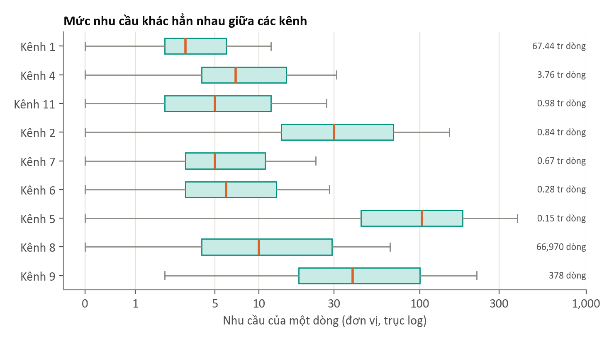

- **Chart này là gì:** mỗi hộp là khoảng từ Q1 đến Q3, vạch cam là trung vị. Chart được tính chính xác từ value count; các điểm ngoại lệ không vẽ vì có hàng triệu điểm.
- **Cách đọc:** hộp càng nằm bên phải thì đơn hàng của kênh đó càng lớn.
- **Phát hiện:** trung vị kênh 1 = 3, kênh 2 = 30, kênh 5 = 103, tức chênh nhau khoảng 34 lần.
- **Ý nghĩa:** không nên so sánh hay đặt ngưỡng chung cho mọi kênh. Con số "trung bình 7.22" chủ yếu phản ánh kênh 1.

### KDE theo kênh: `05_kde_channel.png`
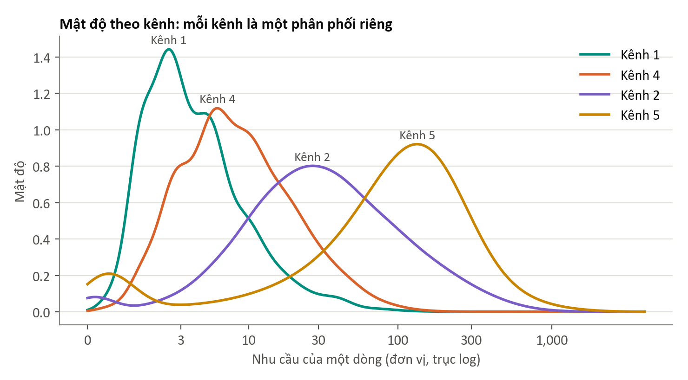

- **Chart này là gì:** phiên bản làm mượt của histogram, giúp so sánh hình dạng phân phối giữa các kênh trên cùng một trục.
- **Cách đọc:** đỉnh càng lệch phải thì đơn hàng điển hình càng lớn; đường càng rộng thì càng phân tán.
- **Phát hiện:** 4 kênh lớn có 4 đỉnh tách biệt theo thứ tự: kênh 1, kênh 4, kênh 2, kênh 5.
- **Ý nghĩa:** `Canal_ID` là một đặc trưng mạnh để dự báo nhu cầu.
- **Lưu ý:** dữ liệu là số nguyên nên có thêm nhiễu nhỏ để làm mượt. Chart này chỉ dùng để xem hình dạng, không dùng để đọc số chính xác.

## Bước 4. Dữ liệu phân loại

Tỷ trọng theo kênh đã có ở slide Data Skew, nên phần này xem theo bang, brand và mức độ tập trung.

### Count plot theo bang: `06_state_bar.png`
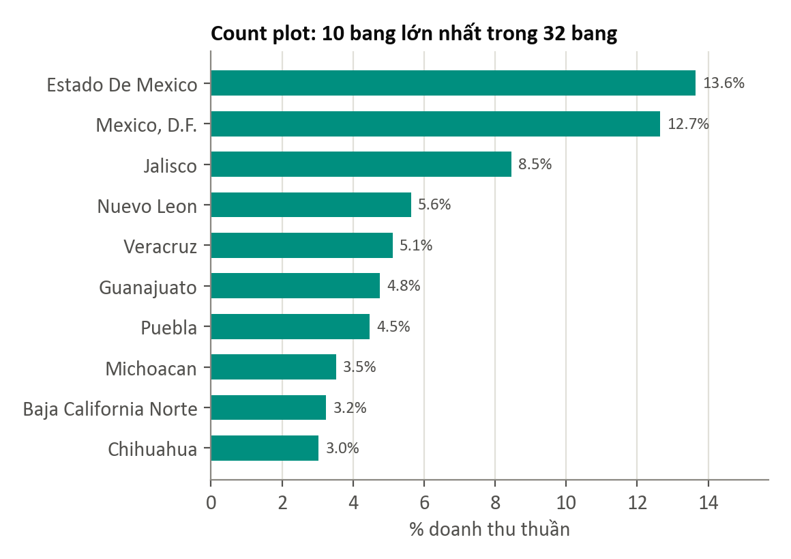

- **Cách đọc:** mỗi thanh là % doanh thu thuần của một bang, sắp từ lớn đến nhỏ.
- **Phát hiện:** 4 bang lớn nhất (Estado de México, México D.F., Jalisco, Nuevo León) chiếm 40.4% doanh thu trong tổng số 32 bang.
- **Ý nghĩa:** các phân tích theo bang nên báo cáo cả phần trăm, vì bang nhỏ có ít dữ liệu hơn nhiều.

### Biểu đồ tròn theo brand: `07_brand_donut.png`
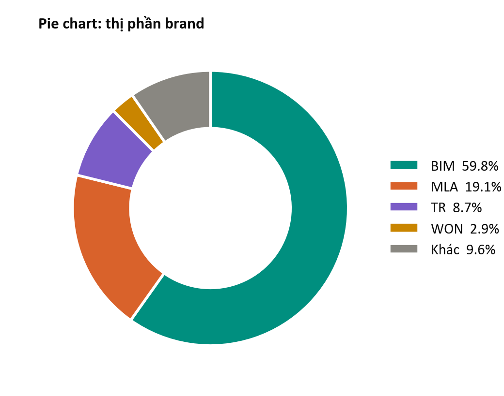

- **Cách đọc:** mỗi phần là thị phần doanh thu thuần của một brand.
- **Phát hiện:** BIM 59.8%, MLA 19.1%, TR 8.7%; ba brand chiếm gần 88%.
- **Vì sao gộp "Khác":** có tới 44 mã brand, vẽ hết sẽ không đọc được.

### Đường Lorenz: `08_lorenz.png`
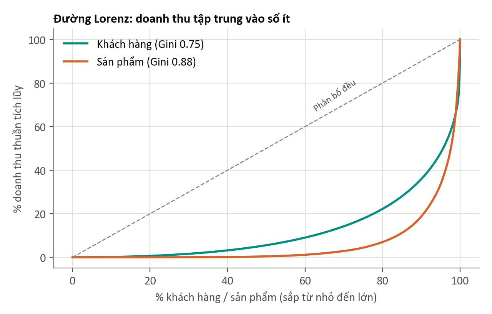

- **Chart này là gì:** sắp xếp từ nhỏ đến lớn rồi cộng dồn doanh thu. Đường càng võng xa đường chéo thì doanh thu càng tập trung. Hệ số Gini đo độ võng này: 0 là hoàn toàn đều, 1 là tập trung tuyệt đối.
- **Phát hiện:**
  - Khách hàng có Gini 0.75: 1% khách lớn nhất tạo 33.2% doanh thu, 10% khách tạo 64.1%.
  - Sản phẩm có Gini 0.88: 10% sản phẩm tạo 81.2% doanh thu.
- **Ý nghĩa:** kiểm soát nhóm lớn sẽ có tác động lớn nhất. Mức tập trung ở sản phẩm cao hơn ở khách hàng.

## Bước 5. Mối quan hệ giữa các biến

### Heatmap tương quan: `09_correlation.png`
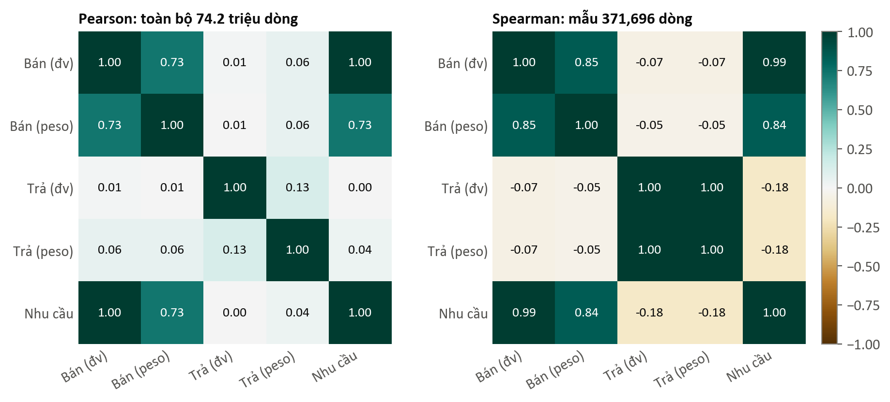

- **Chart này là gì:** Pearson đo quan hệ tuyến tính và rất nhạy với giá trị cực đoan. Spearman đo quan hệ theo thứ hạng nên ít bị ảnh hưởng hơn. Màu đỏ đậm là tương quan dương mạnh, trắng là gần 0.
- **Phát hiện:**
  - Bán và nhu cầu gần như trùng nhau (Pearson 1.00, Spearman 0.99), vì nhu cầu = bán − trả và phần lớn số trả bằng 0. **Không dùng số bán trong tuần để dự báo nhu cầu của chính tuần đó**, vì như vậy là rò rỉ dữ liệu; test cũng không có các cột này.
  - Bán (đơn vị) và bán (peso): Pearson 0.73, Spearman 0.85. Khoảng cách này một phần do giá khác nhau giữa các sản phẩm.
  - Trả (đơn vị) và trả (peso): Pearson chỉ 0.13, nhưng Spearman 1.00. Sự chênh lệch này là dấu hiệu rõ của giá trị cực đoan. Cần nói thêm: Spearman chạm 1.00 một phần vì 96.6% dòng đều bằng 0, và mẫu không chứa dòng 250,000 kia.
  - Hàng trả gần như không tương quan với số bán trên cùng dòng (Pearson 0.01, Spearman −0.07).
- **Ý nghĩa:** khi dữ liệu lệch mạnh, không nên chỉ nhìn Pearson.

### Scatter bán và trả: `10_scatter_sold_returned.png`
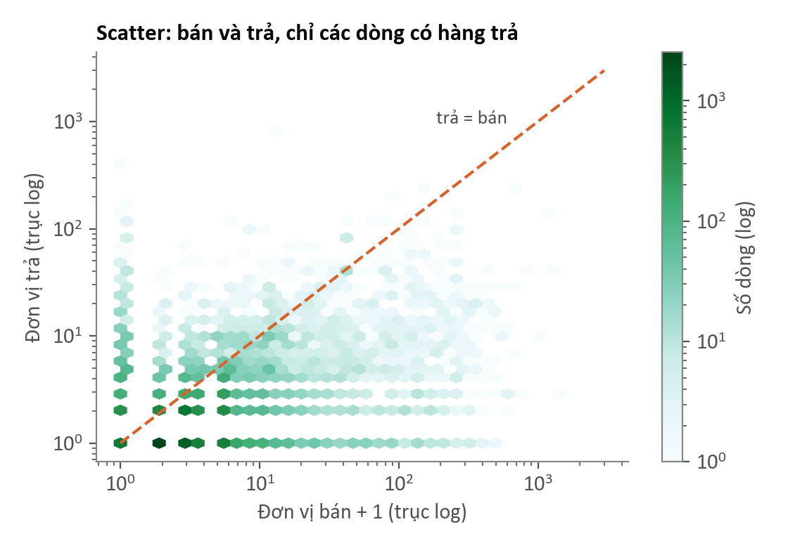

- **Chart này là gì:** biểu đồ tán xạ gom theo ô lục giác (hexbin), vì 12,000+ dòng có hàng trả trên mẫu vẽ thành điểm sẽ chồng kín. Ô càng đậm thì càng nhiều dòng. Đường cam là nơi số trả = số bán.
- **Cách đọc:** điểm nằm trên đường cam là trả nhiều hơn bán trong cùng tuần.
- **Phát hiện:** trong các dòng có hàng trả của mẫu, 24.1% có số trả lớn hơn số bán. Số trả phần lớn rất nhỏ (1–10 đơn vị) ở mọi mức bán.
- **Ý nghĩa:** hàng trả có thể thuộc lần giao trước, nên `return_rate` trên một dòng không phải là tỷ lệ thật. Cần tính tỷ lệ trả trên mức tổng hợp; đó cũng là cách Q2 làm.

## Bước 6. Yếu tố thời gian

### Chuỗi theo tuần: `11_time_series.png`
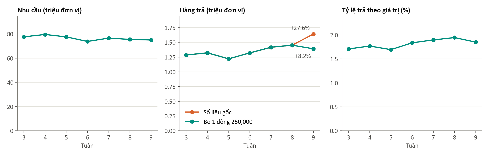

- **Chart này là gì:** 3 biểu đồ nhỏ, mỗi đại lượng một trục riêng. Không gộp vào một biểu đồ hai trục vì dễ gây hiểu sai.
- **Phát hiện quan trọng nhất của EDA:**
  - Nhu cầu đi ngang, 73.9–79.6 triệu đơn vị/tuần.
  - Hàng trả tăng từ 1.29 lên 1.64 triệu đơn vị, tức **+27.6%**. Nhưng tuần 9 có một dòng duy nhất trả **250,000 đơn vị**: "Paletina para Cafe" (que khuấy cà phê), kênh 5, agency 1255, México D.F. Giá trị dòng đó chỉ 2,500 peso (0.01 peso/cái). Sản phẩm này không bán được đơn vị nào trong cả 7 tuần; toàn bộ dữ liệu của nó chỉ là dòng trả này.
  - Riêng dòng này chiếm 15.2% lượng trả của tuần 9. Bỏ nó đi thì mức tăng còn **+8.2%**. Tính theo giá trị thì chỉ **+3.6%**.
  - Tỷ lệ trả theo giá trị tăng nhẹ từ tuần 5 (1.70%) đến tuần 8 (1.95%), rồi giảm ở tuần 9 (1.85%).
- **Ý nghĩa:**
  - Đo hàng trả theo đơn vị sẽ gộp que khuấy 0.01 peso với Pan Blanco khoảng 20 peso. Theo dõi hàng trả **nên dùng giá trị (peso)**.
  - Có thể có một xu hướng tăng nhẹ, nhưng 7 tuần là quá ngắn để khẳng định.
- **Vì sao không phân rã xu hướng/mùa vụ (decomposition):** mùa vụ cần lặp lại nhiều chu kỳ, trong khi dữ liệu chỉ có 7 điểm theo tuần. Làm vẫn ra hình, nhưng hình đó không có ý nghĩa.

### Tự tương quan và độ thưa: `12_lag_sparsity.png`
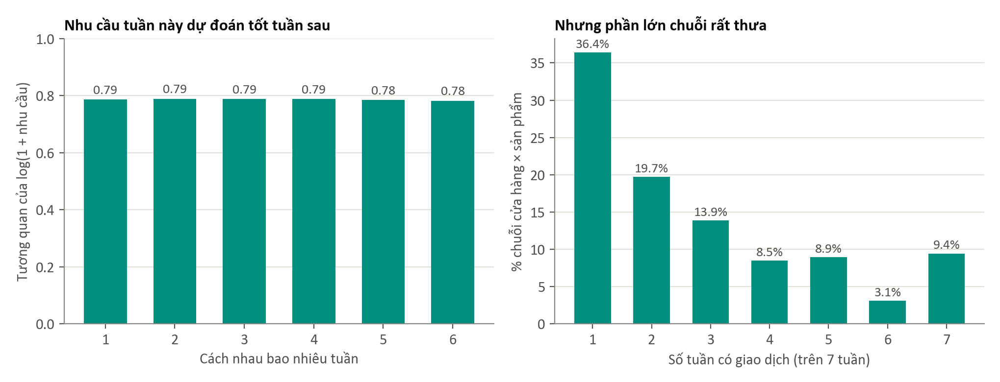

- **Chart này là gì:**
  - *Trái:* với mỗi chuỗi cửa hàng × sản phẩm, so sánh nhu cầu của hai tuần cách nhau 1, 2, …, 6 tuần.
  - *Phải:* số tuần có giao dịch của mỗi chuỗi.
  - Tính trên 2% khách: 1,473,284 dòng, 524,605 chuỗi.
- **Phát hiện:**
  - Tương quan của `log(1 + nhu cầu)` khoảng **0.78–0.79** và gần như không giảm khi cách xa tới 6 tuần. Mức nhu cầu của mỗi chuỗi khá bền vững.
  - **36.4% chuỗi chỉ xuất hiện đúng 1 tuần**; chỉ 9.4% có đủ 7 tuần. Tuy vậy, 65.9% khách có giao dịch đủ cả 7 tuần, nên thưa là ở mức khách × sản phẩm.
- **Ý nghĩa:**
  - Các đặc trưng lag sẽ rất hữu ích, và một mô hình đơn giản như "lấy trung bình các tuần trước" đã là baseline mạnh.
  - Tương quan chỉ tính được trên các cặp tuần cùng có giao dịch, nên chuỗi thưa bị loại khỏi phép đo này. Con số 0.79 không đại diện cho mọi chuỗi.

## Bước 7. Giá trị bất thường

### So sánh phương pháp và theo kênh: `13_outliers.png`
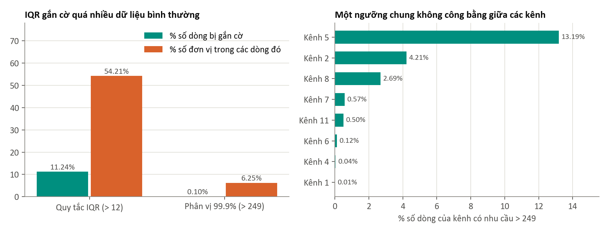

- **Chart này là gì:**
  - *Trái:* so sánh hai cách xác định outlier.
  - *Phải:* tỷ lệ dòng bị gắn cờ `is_outlier` theo từng kênh.
- **Phát hiện:**
  - Quy tắc IQR (Q3 + 1.5 × IQR = 12) gắn cờ **11.24% số dòng**, và các dòng đó chứa **54.21% tổng đơn vị**. Như vậy phần lớn hàng hóa bị xem là "bất thường", nên quy tắc này không phù hợp với dữ liệu lệch mạnh.
  - Ngưỡng 249 của pipeline gắn cờ 0.10% số dòng, chứa 6.25% số đơn vị. Đây là lựa chọn hợp lý hơn.
  - Tuy nhiên, kênh 5 bị gắn cờ 13.19% số dòng, trong khi kênh 1 chỉ 0.01%. Kênh 2 và kênh 5 chiếm 72.6% tổng số dòng bị gắn cờ. Những dòng này phần lớn là đơn hàng lớn bình thường của các kênh đó.
- **Ý nghĩa:** nên đặt ngưỡng outlier theo từng kênh nếu muốn tìm dòng thật sự bất thường. Sau EDA, phần này đã được đưa vào silver (cột `is_outlier_channel`), xem mục 5.5 của báo cáo.
- **Chi tiết về số 249:** phân vị 99.9% chính xác là **251**. Pipeline dùng `approxQuantile` nên ra 249, vẫn nằm trong sai số đã khai báo. Khi nói nên dùng "ngưỡng 249 (xấp xỉ p99.9)".

### Các dòng trả lớn nhất (bảng `top_return_rows.csv`)

| Tuần | Kênh | Bang | Sản phẩm | Bán | Trả | Peso trả |
|---:|---:|---|---|---:|---:|---:|
| 9 | 5 | México D.F. | Paletina para Cafe NES | 0 | 250,000 | 2,500 |
| 3 | 8 | Querétaro | Sand Clasico Dob Fibra LT 98g | 0 | 16,345 | 130,760 |
| 4 | 8 | Querétaro | Sand Clasico Dob Fibra LT 98g | 0 | 12,760 | 102,080 |
| 8 | 8 | San Luis Potosí | Bimkingo Jalapeno 86g | 0 | 9,765 | 93,744 |
| 8 | 11 | Coahuila | Barri Frut Fresa 12p 37g | 7,200 | 6,768 | 20,981 |

Nhóm đầu bảng lặp lại ở vài cửa hàng cố định (khách 1050905 và 4102610, kênh 8), và thường không có số bán ở dòng đó. Đây có thể là trả gộp theo đợt, nhưng dữ liệu không đủ để khẳng định nguyên nhân.

## Bước 8. Phân tích đa biến

Dữ liệu: 88,191 khách (10% khách có số bán > 0). Có 8 đặc trưng: số dòng, số sản phẩm, số tuyến, số tuần hoạt động, đơn vị bán, doanh thu thuần, giá trung bình, tỷ lệ trả. Các đặc trưng được lấy log (trừ số tuần) rồi chuẩn hóa.

### PCA: `14_pca.png`
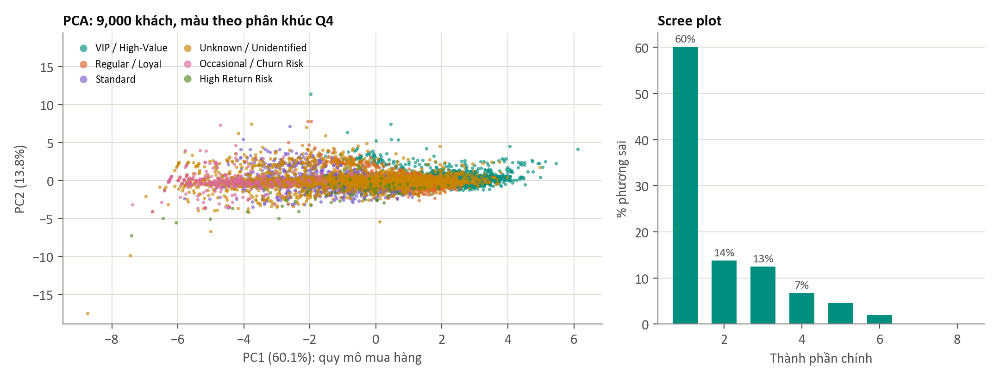

- **Chart này là gì:** PCA nén 8 đặc trưng thành các trục mới giữ được nhiều phương sai nhất. Scree plot cho biết mỗi trục giữ bao nhiêu phần trăm.
- **Phát hiện:**
  - **PC1 giữ 60.2% phương sai** và có trọng số gần bằng nhau trên số dòng, sản phẩm, đơn vị bán, doanh thu: đây là trục "quy mô mua hàng". Khách lớn thì đồng thời mua nhiều dòng, nhiều sản phẩm và có doanh thu cao.
  - **PC2 giữ 13.8%**, gần như chỉ là giá trung bình (trọng số 0.87).
  - Hai trục đầu giữ 73.9%; 6 trục giữ gần như toàn bộ.
  - Dải màu chạy theo PC1: Occasional → Standard → Regular → VIP, đúng như định nghĩa dựa trên doanh thu.
- **Ý nghĩa:** các đặc trưng về quy mô trùng thông tin với nhau. Không có các cụm tách biệt rõ.

### t-SNE: `15_tsne.png`
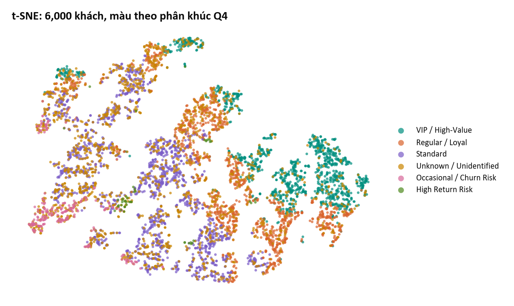

- **Chart này là gì:** t-SNE đặt các khách giống nhau cạnh nhau trên mặt phẳng 2 chiều. Chart giúp nhìn cấu trúc gần, nhưng **khoảng cách giữa các đảo và kích thước đảo không có ý nghĩa**.
- **Phát hiện:** VIP tập trung ở một vùng, các nhóm khác đan xen. Các "đảo" nhiều khả năng một phần do `active_weeks` là số nguyên rời rạc, không nhất thiết là nhóm khách thật.

### Kiểm tra bằng số: silhouette

Silhouette đo mức tách biệt của các cụm: gần 1 là tách rõ, gần 0 là chồng lấn. Mỗi con số là trung bình trên 5 mẫu 20,000 khách, vì một mẫu đơn lẻ có thể làm con số lệch vài phần trăm.

| Cách chia | Silhouette |
|---|---:|
| KMeans k = 2 | 0.41 |
| KMeans k = 3 / 4 / 5 | 0.31 / 0.32 / 0.33 |
| KMeans k = 6 / 7 / 8 | 0.28 / 0.24 / 0.23 |
| Phân khúc theo quy tắc Q4 | **0.016** |

**Ý nghĩa:** dữ liệu là một dải liên tục, không có các cụm tự nhiên rõ. Silhouette của Q4 rất thấp là điều dễ hiểu: Q4 chia bằng ngưỡng nghiệp vụ, và nhóm Unknown dựa trên tên chứ không dựa trên hành vi. Q4 **vẫn dùng được** làm cách chia để ra quyết định, nhưng không nên trình bày như các "nhóm tự nhiên" trong dữ liệu.

### Train và test

| Chỉ số | Giá trị |
|---|---:|
| Dòng test có khách chưa từng thấy trong train | 0.43% |
| Dòng test có sản phẩm chưa từng thấy trong train | 0.37% |
| Dòng test có cặp khách × sản phẩm chưa từng thấy (mẫu 2% khách) | **19.6%** |

**Ý nghĩa:** gần như mọi khách và sản phẩm trong test đều đã xuất hiện, nhưng cứ 5 dòng thì có 1 dòng là cặp mới. Mô hình dự báo cần xử lý được trường hợp này, ví dụ dự phòng bằng mức trung bình của sản phẩm theo agency hoặc theo kênh.

---

## Kết luận theo 8 câu hỏi sau EDA

| Câu hỏi | Trả lời |
|---|---|
| Dữ liệu có đủ và sạch không? | Đủ: 0 null, không trùng khóa trên mẫu. Cần chú ý vài dòng trả cực đoan và 282,025 khách không tên |
| Phân phối có đặc điểm gì? | Lệch phải rất mạnh, hàng trả gần như toàn 0; mỗi kênh một phân phối riêng |
| Giá trị bất thường có hợp lý không? | Phần lớn là đơn lớn thật ở kênh 2, 5. Dòng 250,000 đơn vị cần được kiểm tra riêng |
| Các biến quan hệ thế nào? | Bán ≈ nhu cầu; hàng trả gần độc lập với số bán trên cùng dòng; các biến quy mô trùng thông tin |
| Có xu hướng hay chu kỳ không? | Nhu cầu đi ngang. Tỷ lệ trả theo giá trị có thể tăng nhẹ. 7 tuần chưa đủ để kết luận mùa vụ |
| Đặc trưng nào quan trọng? | Nhu cầu các tuần trước (lag), kênh, sản phẩm, agency, và quy mô khách |
| Cần xử lý gì thêm? | Log nhu cầu; dùng giá trị thay vì đơn vị khi đo hàng trả; ngưỡng outlier theo kênh |
| Hướng mô hình? | Baseline trung bình theo chuỗi, sau đó GBT với đặc trưng lịch sử trên `log(1 + nhu cầu)`; có phương án dự phòng cho cặp mới. Đã thử: GBT giảm 10.3% RMSLE so với baseline, xem mục 5.5 của báo cáo |

## Ảnh hưởng tới các kết quả đã có

EDA không sửa nội dung ban đầu của bài. Các điểm dưới đây cần nhóm cân nhắc:

1. **Slide kết quả Q1, tiêu đề "hàng trả tăng 27.6%":** con số đúng theo phép tính, nhưng mức tăng phần lớn đến từ một dòng. Nên nói kèm +8.2% và +3.6%, hoặc đổi cách diễn đạt. Khuyến nghị "theo dõi xu hướng trả tăng từ tuần 6" vẫn có cơ sở, nhưng mức độ nhẹ hơn nhiều.
2. **Con số "tỷ lệ trả chung 1.70%":** con số này tính từ bảng Q2, vốn đã bỏ các tổ hợp không có số bán (453,782 đơn vị trả, trong đó có dòng 250,000). Trên toàn bộ dữ liệu, con số là 1.78% theo đơn vị (1.74% nếu bỏ dòng 250,000) và 1.81% theo giá trị.
3. **Slide Data Skew, "p99.9 = 249":** con số chính xác là 251; 249 là kết quả của `approxQuantile`.

## Hạn chế của EDA này

- Dataset không công bố tên các kênh, nên chỉ so sánh theo mã `Canal_ID`.
- Chỉ có 7 tuần, không suy ra được mùa vụ.
- Dòng 250,000 đơn vị được nghi là bất thường dựa trên giá và quy mô, nhưng không có nguồn để xác nhận đó là lỗi nhập liệu hay giao dịch thật. Vì vậy dòng này không bị xóa khỏi dữ liệu.
- Tự tương quan, trùng khóa và cặp mới được tính trên mẫu 2% khách, nên là ước lượng.
