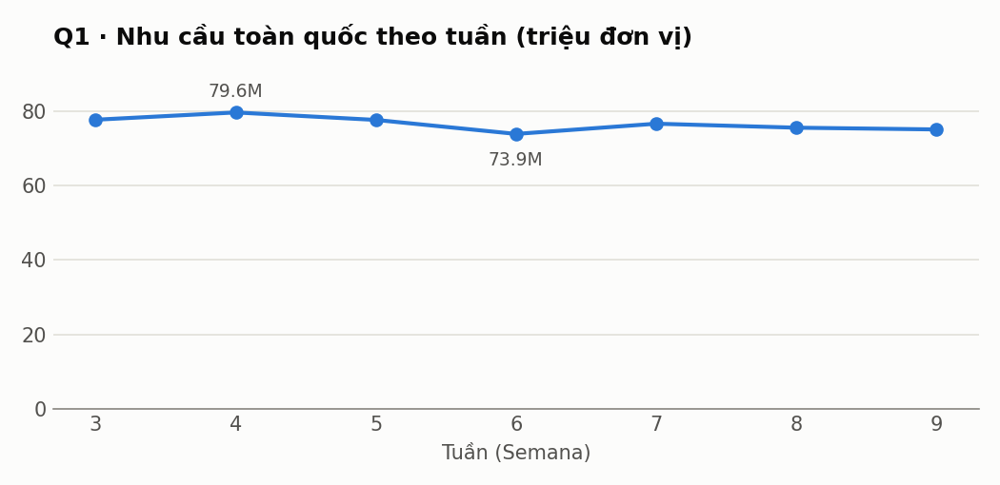
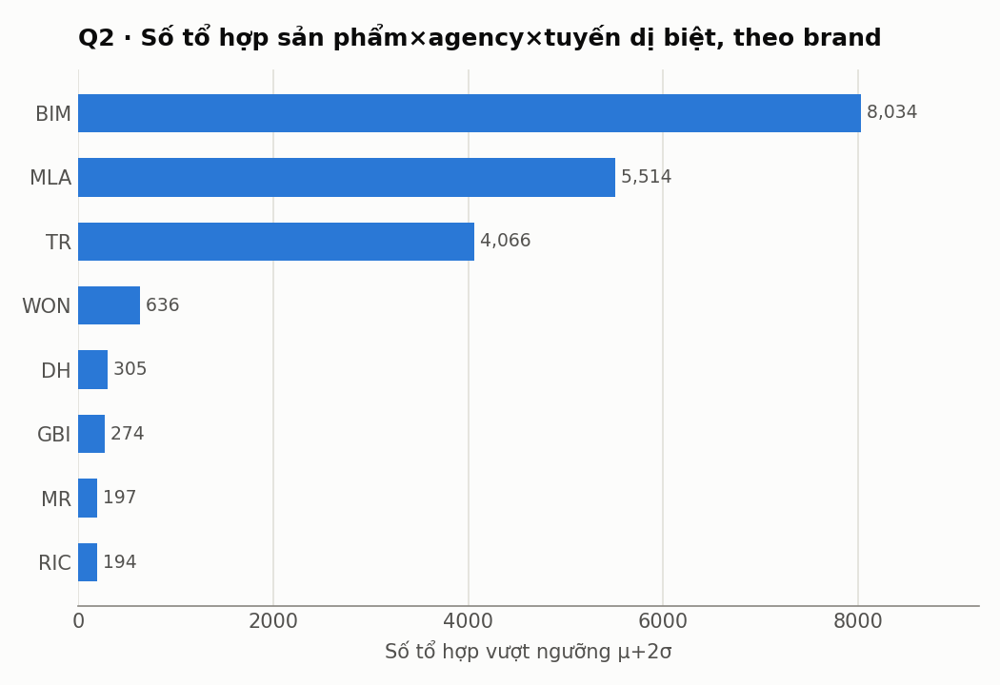
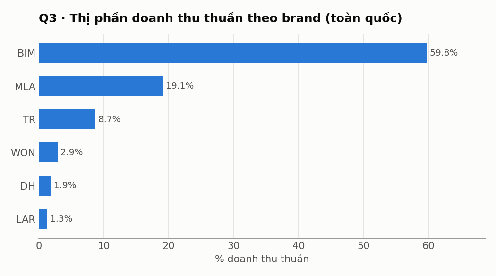
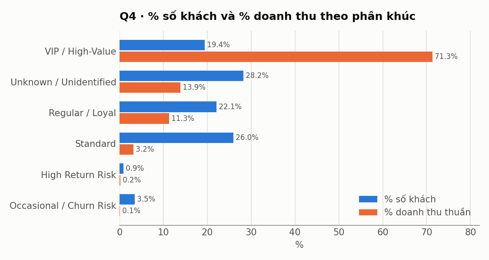

# BÁO CÁO DỰ ÁN CUỐI KỲ: BDT301
## END-TO-END BIG DATA ANALYTICS PIPELINE
### Đề tài: Tối ưu hóa Chuỗi Cung ứng và Dự báo Nhu cầu Phân phối Bánh Grupo Bimbo

---

* **Học phần:** BDT301 – Big Data Technologies
* **Trọng số:** 25%
* **Tập dữ liệu:** Grupo Bimbo Inventory Demand (~3.5 GB raw, 74.2 triệu dòng)
* **Kho lưu trữ:** `https://github.com/GiaHuy-K/BDT_Project`

---

## 1. Giới thiệu Bài toán và Câu hỏi Nghiệp vụ (Problem & Business Questions)

### 1.1. Bối cảnh Doanh nghiệp
**Grupo Bimbo** là tập đoàn sản xuất và phân phối bánh nướng lớn nhất thế giới. Mô hình vận hành của Bimbo dựa trên chuỗi cung ứng giao hàng trực tiếp đến cửa hàng (Direct-Store Delivery - DSD) với hơn 1 triệu điểm bán lẻ tại Mexico, trải rộng trên hàng chục ngàn tuyến đường mỗi ngày. 

Đặc thù của sản phẩm bánh mì là **hạn sử dụng ngắn** (shelf-life ngắn). Khi sản phẩm hết hạn mà chưa bán được, tài xế giao hàng sẽ nhận lại hàng tồn ở tuần tiếp theo (`Dev_proxima`). Thách thức lớn của Bimbo là:
* Nếu cung ứng thiếu: Mất doanh thu và mất lòng tin của khách hàng.
* Nếu cung ứng thừa: Tỷ lệ hàng đổi trả cao dẫn đến chi phí tiêu hủy và hao tổn tài chính khổng lồ.

Hệ thống phân tích cũ bị chậm, phân mảnh và không thể xử lý khối lượng dữ liệu giao dịch hàng chục gigabyte theo thời gian thực. Dự án này xây dựng một **nền tảng Big Data hoàn chỉnh (End-to-End Pipeline)** nhằm thu thập, lưu trữ, xử lý phân tán với Apache Spark, và đưa ra quyết định kinh doanh dựa trên dữ liệu.

### 1.2. Bốn câu hỏi Nghiệp vụ Trọng tâm (Business Questions)

1. **Q1 (Nhu cầu theo thời gian & khu vực):** Nhu cầu tiêu thụ bánh và doanh thu thay đổi như thế nào qua từng tuần (`Semana 3–9`), theo từng bang và từng kênh phân phối? Tốc độ tăng trưởng tuần qua tuần (WoW%) là bao nhiêu?
2. **Q2 (Phát hiện dị biệt trong tỷ lệ hoàn hàng):** Những sản phẩm, đại lý (`Agencia_ID`) và tuyến giao hàng (`Ruta_SAK`) nào có tỷ lệ trả hàng cao bất thường (vượt quá ngưỡng kiểm soát $\mu + 2\sigma$)?
3. **Q3 (Xếp hạng sản phẩm & thị phần thương hiệu):** Top 10 sản phẩm bán chạy nhất và tỷ trọng doanh thu đóng góp của từng thương hiệu (`brand`) tại mỗi bang là bao nhiêu?
4. **Q4 (Phân khúc điểm bán lẻ):** Khách hàng/điểm bán lẻ được phân khúc như thế nào dựa trên tần suất mua hàng (`active_weeks`), doanh số đóng góp và rủi ro hoàn hàng để tối ưu chính sách tín dụng và chăm sóc?

---

## 2. Dữ liệu và Quy trình Ingestion (Dataset & Ingestion)

### 2.1. Nguồn và Quy mô Dữ liệu
Dự án sử dụng bộ dữ liệu chính thức từ cuộc thi Kaggle [Grupo Bimbo Inventory Demand](https://www.kaggle.com/competitions/grupo-bimbo-inventory-demand/data) với tổng dung lượng dữ liệu thô **~3.5 GB**:

| Tên tệp | Vai trò | Kích thước | Số dòng | Mô tả |
| :--- | :--- | :--- | :--- | :--- |
| `train.csv` | Fact Table | 3,199 MB | 74,180,464 | Giao dịch bán lẻ từ tuần 3 đến tuần 9 |
| `test.csv` | Fact Table | 251 MB | 6,999,251 | Dữ liệu giao hàng tuần 10–11 |
| `cliente_tabla.csv` | Dimension | 21 MB | 935,362 | Danh mục mã khách hàng và tên điểm bán |
| `producto_tabla.csv` | Dimension | 0.1 MB | 2,592 | Danh mục mã sản phẩm và mô tả tên bánh |
| `town_state.csv` | Dimension | < 0.1 MB | 790 | Danh mục đại lý phân phối, thành phố và bang |

### 2.2. Vấn đề Chất lượng Dữ liệu Thô (Data Quality Issues)
* **Khóa chính trùng lặp:** File `cliente_tabla` có 935,362 dòng nhưng chỉ 930,500 `Cliente_ID` khác nhau (4,862 ID lặp lại, thường là cùng một điểm bán với tên viết khác nhau).
* **Dữ liệu thiếu định danh:** 282,025 khách hàng (30% sau dedup) có tên `"NO IDENTIFICADO"` hoặc `"SIN NOMBRE"`; các khách này chiếm 13,259,253 dòng giao dịch (17.9%), nên không thể bỏ đi mà phải gắn cờ `is_unknown_client`.
* **Hàng trả vượt hàng bán:** 615,828 dòng có `Dev_uni_proxima > Venta_uni_hoy` vì hàng trả tuần này có thể thuộc lần giao trước; giữ lại và gắn cờ.
* **Nhu cầu bằng 0:** 1,336,821 dòng (1.8%) có `Demanda_uni_equil = 0`.
* **Cấu trúc trường phi chuẩn:** Tên sản phẩm trong `producto_tabla` gộp chung cả tên bánh, số lượng đóng gói (`pieces`), trọng lượng (`weight_g`), và mã thương hiệu (`brand`).
* **Ký tự đặc biệt & Encoding:** Tên bang và địa danh chứa chữ có dấu tiếng Tây Ban Nha (`Á, É, Í, Ó, Ú, Ñ`), gây lỗi font chữ nếu đọc ở chuẩn mã hóa thông thường.
* **Phân phối lệch (Skewness):** Nhu cầu hàng hóa dao động lớn (trung bình 7.2 cái, giá trị lớn nhất lên đến 5,000 cái); kênh phân phối số 1 chiếm hơn 91% tổng số lượng bản ghi.

### 2.3. Thiết kế Ingestion Tự động & Lặp lại (Repeatable Ingestion)
Quy trình nạp dữ liệu được tự động hóa qua script `ingestion/ingest.py`:
1. Nếu `data/` chưa có zip (hoặc thư mục đã giải nén), tự tải bằng Kaggle API.
2. Đọc luồng từng CSV bên trong các zip lồng nhau và đẩy trực tiếp lên **MinIO bucket `raw/`** mà không giải nén ra ổ đĩa cục bộ.
3. Tính **SHA-256** và đếm số dòng ngay trong lúc stream (một lần đọc). Nếu object trên MinIO đã có cùng SHA-256 thì bỏ qua (idempotent); nếu nội dung nguồn khác mà không truyền `--force` thì dừng với lỗi thay vì âm thầm ghi đè.
4. Ghi manifest `ingest_<timestamp>.json` (kích thước, số dòng, SHA-256, trạng thái) vào cả MinIO (`raw/grupo_bimbo/_manifests/`) và `logs/` để truy vết nguồn gốc.

---

## 3. Thiết kế Kiến trúc và Tầng Lưu trữ (Architecture & Storage)

### 3.1. Medallion Architecture
Hệ thống áp dụng kiến trúc dữ liệu chuẩn công nghiệp gồm các tầng tách biệt:

1. **Raw Storage (MinIO `s3a://raw`):** Lưu trữ file CSV gốc nguyên bản, không chỉnh sửa, thiết lập quyền đọc bất biến (immutable data lake).
2. **Bronze Layer (`s3a://processed/bronze`):** Chuyển đổi toàn bộ CSV thành định dạng nén cột **Apache Parquet**, áp dụng schema tĩnh tường minh (`StructType`), bổ sung trường audit (`_source_file`, `_ingested_at`), và phân vùng theo tuần giao dịch (`partitionBy("Semana")`).
3. **Silver Layer (`s3a://processed/silver`):** 
   - Làm sạch, khử trùng lặp dimension.
   - Trích xuất đặc trưng sản phẩm bằng Regular Expression (tách số cái, số gram, tên thương hiệu).
   - Chuẩn hóa tên bang địa lý.
   - Thực hiện Broadcast Join giữa bảng Fact và 3 bảng Dimension.
   - Phân loại dữ liệu không hợp lệ vào bảng `rejected` kèm lý do.
   - Thiết lập kiểm tra bất biến dữ liệu: `fact_sales + rejected == bronze_train`.
4. **Gold Layer (`s3a://processed/gold`):** Tổng hợp dữ liệu đa chiều (denormalized aggregates) thành 4 bảng phục vụ trực tiếp cho 4 câu hỏi nghiệp vụ Q1–Q4.
5. **Serving Layer (PostgreSQL 16):** `export_postgres.py` ghi 4 bảng Gold vào schema `gold` qua JDBC (ghi đè cả định nghĩa bảng để luôn khớp schema Gold), rồi tạo index trên các cột mà query phân tích lọc/sắp xếp (`State`, `rank`, `is_anomaly`, `segment`).
6. **Presentation Layer (Metabase):** Kết nối trực tiếp vào PostgreSQL, cung cấp bảng điều khiển trực quan (BI dashboard) cho các nhà quản lý chuỗi cung ứng.

---

## 4. Xử lý Dữ liệu với Apache Spark (Spark Processing)

### 4.1. Cấu hình Cụm Phân tán (Distributed Spark Cluster)
Cụm Spark 3.5.3 được vận hành trong mạng Docker với:
* **Spark Master:** Điều phối tài nguyên và quản lý đồ thị tính toán (DAG).
* **2 Spark Workers:** Mỗi worker có 2 CPU cores và 2 GB RAM; mỗi executor dùng 1.5 GB (`config/spark-defaults.conf`), bật Adaptive Query Execution và `skewJoin`.
* **Spark History Server:** Ghi nhận toàn bộ event log tính toán tại cổng `18080` làm bằng chứng thực thi độc lập.
* **Gói tích hợp phụ thuộc:** `hadoop-aws:3.3.4`, `aws-java-sdk-bundle:1.12.262`, và `postgresql:42.7.4`.

### 4.2. Các biến đổi quan trọng (Transformations)
1. **Trích xuất thông tin sản phẩm (Regex Parsing)** – ví dụ `"Bimbollos Ext sAjonjoli 6p 480g BIM 41"` → 6 cái, 480 g, brand `BIM` (trích từ `spark_jobs/silver.py`):
   ```python
   weight_val = F.regexp_extract(name, r"(?i)\b(\d+(?:\.\d+)?)\s?(kg|g|ml)\b", 1)   # kg được đổi sang gram
   pieces     = F.regexp_extract(name, r"(?i)\b(\d+)p\b", 1)
   brand      = F.regexp_extract(name, r"\s(\S+)\s+\d+\s*$", 1)   # token ngay trước ID ở cuối tên
   ```
   Kết quả: tách được trọng lượng cho 2,528/2,592 sản phẩm, brand cho 2,591 sản phẩm (45 brand), số cái cho 1,124 sản phẩm.
2. **Khử trùng lặp khách hàng:** chuẩn hóa tên (viết hoa, bỏ dấu, gộp khoảng trắng); với ID trùng, dùng Window `row_number()` giữ dòng có tên thật thay vì UNKNOWN, rồi đến tên dài nhất – thay vì `dropDuplicates` giữ dòng ngẫu nhiên. Sau khi ghi, job kiểm tra khóa duy nhất để join không nhân bản dòng fact.
3. **Join và kiểm soát chất lượng fact:** broadcast join 74 triệu dòng với 3 dimension; 7 quy tắc loại dòng (thiếu khóa, thiếu số đo, giá trị âm, bán mà doanh thu 0, agency/sản phẩm/khách không có trong dimension) đẩy dòng lỗi sang bảng `rejected` kèm `reason`. Outlier (nhu cầu > phân vị 99.9% = 249 đơn vị, 75,223 dòng) được gắn cờ chứ không xóa. Cờ `demand_mismatch` = 0 dòng xác nhận `Demanda_uni_equil = max(Venta_uni_hoy − Dev_uni_proxima, 0)` đúng trên toàn bộ dữ liệu.
4. **Q1 – Window `lag()`:** tổng hợp theo tuần × bang × kênh, rồi `lag()` trên Window `(State, Canal_ID)` sắp theo `Semana` để tính % thay đổi tuần qua tuần của nhu cầu và doanh thu.
5. **Q2 – Phát hiện dị biệt (2-Sigma):** tổng hợp theo sản phẩm × agency × tuyến; tính $\mu$, $\sigma$ của tỷ lệ trả chỉ trên các nhóm bán ≥ 20 đơn vị để nhóm quá nhỏ không làm méo ngưỡng; ngưỡng (1 dòng) được `broadcast` + `crossJoin` vào mọi nhóm:
   $$\text{Threshold} = \mu_{\text{return\_rate}} + 2 \cdot \sigma_{\text{return\_rate}}$$
   Nhóm bán ≥ 20 đơn vị và vượt ngưỡng được đánh dấu `is_anomaly = True`.
6. **Q3 – Xếp hạng:** `dense_rank()` trên Window theo `State` sắp theo doanh thu thuần, và `sum().over(Window theo State)` để tính `revenue_share_pct`.
7. **Q4 – Phân khúc khách hàng theo luật (rule-based, không phải ML):**
   Dựa trên 7 tuần giao dịch, tính số tuần hoạt động (`active_weeks`), doanh thu thuần (`net_revenue`) và tỷ lệ trả hàng, rồi gán nhãn theo thứ tự ưu tiên:
   * *Unknown / Unidentified*: khách không rõ tên (`is_unknown_client`).
   * *VIP / High-Value*: doanh thu thuần ≥ 10,000 pesos, hoặc ≥ 5 tuần và ≥ 5,000 pesos.
   * *High Return Risk*: tỷ lệ trả ≥ 15% và ≥ 20 đơn vị trả.
   * *Regular / Loyal*: ≥ 4 tuần và ≥ 1,500 pesos.
   * *Occasional / Churn Risk*: ≤ 2 tuần.
   * *Standard*: còn lại.
   Các ngưỡng do nhóm tự đặt theo phân phối doanh thu; đây là một hạn chế (xem mục 7).

### 4.3. Bằng chứng Thực thi trên Toàn bộ Dữ liệu
Lần chạy `./run.sh` hoàn chỉnh (infra → export) được lưu trong `logs/evidence/`: log chạy kèm `applicationId` của từng Spark job (xem lại DAG/stage trên Spark History Server, cổng 18080), manifest ingestion và báo cáo chất lượng silver.

| Tầng | Kết quả |
| :--- | :--- |
| Raw (MinIO) | 5 CSV, 3.3 GB, SHA-256 trong manifest |
| Bronze | train 74,180,464 · test 6,999,251 · cliente 935,362 · producto 2,592 · town_state 790 dòng (khớp 100% nguồn); Parquet 591 MB |
| Silver | fact_sales 74,180,464 + rejected 0 = bronze train (`invariant_ok: true`); dim_cliente 930,500 · dim_producto 2,592 · dim_agencia 790 (33 → 32 bang) |
| Gold / PostgreSQL | Q1 1,393 · Q2 1,062,353 · Q3 17,604 · Q4 880,604 dòng |

---

## 5. Kết quả Phân tích & Giá trị Nghiệp vụ (Analytical Results & Insights)
Mọi con số dưới đây lấy từ các bảng `gold.*` trong PostgreSQL sau lần chạy trong `logs/evidence/`; query nằm ở `sql/analysis/` và `sql/analysis/report_figures.sql`, biểu đồ được vẽ lại bằng `notebooks/report_figures.py` từ chính các bảng đó. Dashboard Metabase dùng cùng các query trong `sql/analysis/` (hướng dẫn ở `dashboard/README.md`).

### 5.1. Kết quả Q1: Xu hướng Nhu cầu và Doanh thu qua các Tuần

* **Phát hiện:**
  * Nhu cầu toàn quốc ổn định ở mức 73.9–79.6 triệu đơn vị/tuần (doanh thu 702–756 triệu pesos/tuần); tuần 6 giảm mạnh nhất (−4.8% so với tuần 5), không có xu hướng tăng hay giảm kéo dài trong 7 tuần.
  * Kênh 1 chiếm 91% số dòng giao dịch nhưng chỉ **72.1% số đơn vị**, vì mỗi đơn của kênh này nhỏ. Kênh 2 chiếm 9.6% đơn vị nhưng giá trị mỗi đơn vị cao gấp ~2.25 lần (18.3 so với 8.1 pesos).
  * Tỷ lệ trả hàng theo kênh khác biệt rõ: kênh 5 (6.3%) và kênh 8 (6.1%) cao gấp ~4 lần kênh 1 (1.6%).
* **Khuyến nghị:** Kế hoạch sản xuất có thể dựa trên mức nền ổn định theo tuần; ưu tiên rà soát lượng giao cho kênh 5 và 8, nơi tỷ lệ trả cao nhất.

### 5.2. Kết quả Q2: Tuyến đường & Sản phẩm có Tỷ lệ Trả hàng Dị biệt

* **Phát hiện:**
  * Trên 913,039 tổ hợp sản phẩm × agency × tuyến có ≥ 20 đơn vị bán, tỷ lệ trả trung bình là 3.5%; ngưỡng $\mu + 2\sigma$ = **31.5%**. Có **20,208** tổ hợp (2.2%) vượt ngưỡng.
  * Các tổ hợp dị biệt này giữ **16.5%** tổng giá trị hàng trả: hàng trả tập trung một phần, nhưng phần lớn vẫn rải đều trên các tuyến bình thường.
  * Dị biệt nhiều nhất thuộc brand BIM (8,034), MLA (5,514) và TR (4,066) – cũng là các brand có nhiều tổ hợp nhất. Ca nặng nhất: *Bimkingo Jalapeño* tuyến 5712 ở San Luis Potosí trả 34,515 đơn vị so với 15,156 bán. Tỷ lệ > 100% xảy ra vì hàng trả trong tuần có thể là của các lần giao trước.
* **Khuyến nghị:** Dùng danh sách `is_anomaly` để rà soát lượng giao theo từng tuyến cụ thể; nhưng vì chỉ ~1/6 giá trị trả nằm ở các tuyến dị biệt, việc giảm hàng trả cần thêm chính sách chung (ví dụ dự báo nhu cầu theo tuyến) chứ không chỉ xử lý các tuyến này.

### 5.3. Kết quả Q3: Xếp hạng Sản phẩm và Thị phần Thương hiệu theo Bang

* **Phát hiện:**
  * Doanh thu thuần tập trung vào brand BIM (59.8%), MLA – Marinela (19.1%) và TR (8.7%).
  * *Pan Blanco 640g* đứng hạng 1 ở 11 bang và lọt top 3 ở 25/32 bang. *Nito 1p 62g Central* đứng hạng 1 ở 10 bang (ví dụ Jalisco, 8.6% doanh thu bang), cho thấy sản phẩm dẫn đầu khác nhau theo vùng.
  * Thị trường phân mảnh: ở Mexico, D.F. sản phẩm hạng 1 chỉ chiếm 4.4% doanh thu bang.
* **Khuyến nghị:** Danh mục sản phẩm ưu tiên nên đặt theo từng bang (dựa trên `rank` của Q3) thay vì một danh sách chung toàn quốc.

### 5.4. Kết quả Q4: Phân khúc Khách hàng Điểm bán


| Phân khúc | Số khách | % khách | % doanh thu thuần | Tỷ lệ trả |
| :--- | ---: | ---: | ---: | ---: |
| VIP / High-Value | 170,517 | 19.4% | 71.3% | 1.6% |
| Unknown / Unidentified | 248,436 | 28.2% | 13.9% | 1.7% |
| Regular / Loyal | 194,654 | 22.1% | 11.3% | 1.6% |
| Standard | 228,584 | 26.0% | 3.2% | 1.9% |
| Occasional / Churn Risk | 30,579 | 3.5% | 0.1% | 1.6% |
| High Return Risk | 7,834 | 0.9% | 0.2% | 34.7% |

* **Phát hiện:**
  * Doanh thu tập trung mạnh: 19.4% khách (VIP) tạo 71.3% doanh thu thuần; nhóm VIP hoạt động đủ cả 7 tuần.
  * Nhóm *High Return Risk* nhỏ (7,834 khách, 0.2% doanh thu) nhưng tỷ lệ trả 34.7%, gấp ~20 lần các nhóm khác (~1.6–1.9%).
  * 28% khách có giao dịch không rõ tên nhưng vẫn tạo 13.9% doanh thu – chất lượng dữ liệu khách hàng là vấn đề nghiệp vụ thật.
* **Khuyến nghị:** Ưu tiên dịch vụ cho nhóm VIP; với nhóm High Return Risk, giảm lượng giao mặc định hoặc áp dụng giới hạn đổi trả; bổ sung thông tin cho nhóm Unknown.

---

## 6. Độ tin cậy, Rủi ro Thất bại & Đánh đổi Kiến trúc (Reliability & Trade-offs)

### 6.1. Nhận diện Rủi ro Thất bại và Giải pháp
1. **Rủi ro Memory OOM (Out Of Memory) trong Spark:**
   - *Nguyên nhân:* Xử lý 74 triệu bản ghi trên cụm máy ảo với tài nguyên RAM hạn chế (1.5 GB/worker) dễ dẫn đến lỗi tràn bộ nhớ khi thực hiện Full Outer Join hoặc Shuffle dữ liệu lớn.
   - *Giải pháp:* Áp dụng triệt để cơ chế **Broadcast Join** cho các bảng dimension kích thước nhỏ; phân vùng Parquet theo `Semana` để Spark chỉ nạp đúng partition cần tính toán; tránh sử dụng `.cache()` toàn bộ dữ liệu 74 triệu dòng vào RAM khi không cần thiết.
2. **Rủi ro Dị biệt Dữ liệu (Data Corruption & Incomplete Ingestion):**
   - *Nguyên nhân:* Kết nối gián đoạn khi tải/nạp có thể làm hỏng hoặc cắt cụt file CSV thô.
   - *Giải pháp:* Kiểm tra **SHA-256** tại tầng Ingestion và chốt chặn **Invariant Check** ở Silver: nếu `fact_sales + rejected != bronze_train`, job báo lỗi và dừng (fail-fast), ngăn dữ liệu sai đi tiếp vào Gold.
3. **Sự cố thực tế: hết dung lượng ổ đĩa (đã xảy ra khi chạy dự án):**
   - *Nguyên nhân:* Ổ đĩa ảo của Docker (`docker_data.vhdx`) phình lên khi MinIO nhận 3.3 GB raw và Spark ghi lại các tầng Parquet; ổ C còn 20 MB, Docker engine dừng giữa bước ingest và báo lỗi `input/output error`.
   - *Xử lý:* Chuyển dữ liệu Docker và file swap của WSL sang ổ D. Vì ingestion idempotent, chạy lại `./run.sh` chỉ tải lại file đang dở; Spark ghi `mode("overwrite")` nên chạy lại không nhân đôi dữ liệu. *Trên production:* giám sát dung lượng, cảnh báo sớm, và dùng object storage có thể mở rộng.
4. **Sự cố thực tế: lệch schema ở tầng serving:**
   - *Nguyên nhân:* Khi Gold Q1 thêm cột, export với `truncate=true` giữ định nghĩa bảng PostgreSQL cũ nên lỗi `Column return_units not found`.
   - *Xử lý:* Export ghi đè cả định nghĩa bảng rồi tạo lại index, để bảng serving luôn khớp schema Gold. *Trên production:* quản lý migration schema có phiên bản.

### 6.2. Phân tích Đánh đổi Kiến trúc (Trade-offs)
* **Batch Processing vs. Real-time Streaming:** Dữ liệu được ghi nhận theo tuần và hàng trả chỉ biết ở chu kỳ giao sau, nên batch là đủ. Đổi lại độ trễ (~13 phút cho một lần chạy đầy đủ) lấy hạ tầng đơn giản, không cần duy trì Kafka + Spark Streaming 24/7.
* **Normalized vs. Denormalized Storage:** Silver giữ 3 bảng dimension riêng nhưng `fact_sales` được join sẵn tên khách hàng, sản phẩm, bang (denormalize), nên silver lớn hơn bronze (1.2 GB so với 591 MB) nhưng Gold không phải join lại 74 triệu dòng. Gold tiếp tục làm phẳng thành 4 bảng tổng hợp để PostgreSQL/Metabase chỉ quét tối đa ~1 triệu dòng thay vì 74 triệu.
* **Partition theo tuần:** fact được `partitionBy("Semana")` vì hầu hết câu hỏi lọc/gom theo tuần; đổi lại số file nhiều hơn và không tối ưu cho truy vấn theo khách hàng.
* **Gắn cờ thay vì xóa:** outlier, nhu cầu 0, hàng trả vượt hàng bán được giữ kèm cờ để tổng doanh thu không bị sai; đổi lại mỗi query phân tích phải tự quyết định có lọc cờ hay không.

---

## 7. Đánh giá Hạn chế và Hướng Phát triển (Limitations & Future Work)
* **Hạn chế:**
  * Pipeline được điều phối qua bash script `run.sh`, chưa có lập lịch và cơ chế tự động thử lại (retry) khi một bước thất bại (hiện chỉ chạy lại thủ công từ bước lỗi: `./run.sh <step>`).
  * Chạy trên một máy với Docker Desktop: đây là single point of failure và giới hạn bởi RAM/ổ đĩa của máy (xem sự cố ở mục 6.1).
  * Ngưỡng phân khúc Q4 đặt thủ công; ngưỡng Q2 dùng $\mu + 2\sigma$ trên phân phối lệch phải nên nhạy với giá trị cực đoan.
  * Dữ liệu chỉ có 7 tuần, chưa đủ để kết luận về mùa vụ.
* **Hướng phát triển:** 
  1. Triển khai **Apache Airflow** để điều phối và lập lịch pipeline tự động.
  2. Nâng cấp định dạng lưu trữ sang **Delta Lake** hoặc **Apache Iceberg** để hỗ trợ giao dịch ACID và Time-Travel.
  3. Xây dựng mô hình Machine Learning dự báo nhu cầu chính xác cho tuần 10–11 sử dụng thư viện **Spark MLlib** (ví dụ: GBDT / Random Forest Regressor).
  4. Thay phân khúc theo luật bằng KMeans (`pyspark.ml`) và ngưỡng dị biệt theo phân vị hoặc theo từng brand.

---

## 8. Kết luận
Dự án đã xây dựng thành công một pipeline phân tích dữ liệu lớn hoàn chỉnh (End-to-End Big Data Analytics Pipeline), xử lý thành công toàn bộ **74.2 triệu bản ghi (~3.5 GB)** dữ liệu phân phối của tập đoàn Grupo Bimbo. Pipeline chạy lại được bằng một lệnh, kiểm chứng không mất dòng nào qua các tầng (invariant), và trả lời 4 câu hỏi nghiệp vụ bằng số liệu thật: nhu cầu ổn định theo tuần, hàng trả dị biệt ở 2.2% tổ hợp tuyến, sản phẩm dẫn đầu khác nhau theo bang, và 19% khách hàng tạo 71% doanh thu. Các hạn chế ở mục 7 là hướng cải tiến tiếp theo.

