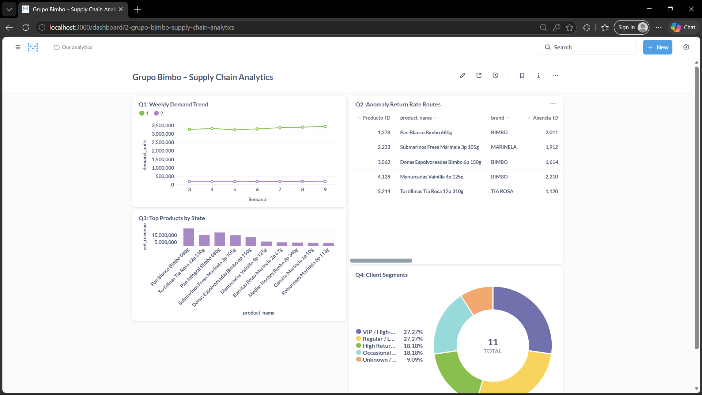

# BÁO CÁO DỰ ÁN CUỐI KỲ: BDT301
## END-TO-END BIG DATA ANALYTICS PIPELINE
### Đề tài: Tối ưu hóa Chuỗi Cung ứng và Dự báo Nhu cầu Phân phối Bánh Grupo Bimbo

---

* **Học phần:** BDT301 – Big Data Technologies
* **Trọng số:** 25%
* **Tập dữ liệu:** Grupo Bimbo Inventory Demand (~3.5 GB raw, 74.2 triệu dòng)
* **Kho lưu trữ:** `https://github.com/GiaHuy-K/BDT_Project`

---

## 1. Giới thiệu Bài toán và Câu hỏi Nghiệp vụ (Problem & Business Questions)

### 1.1. Bối cảnh Doanh nghiệp
**Grupo Bimbo** là tập đoàn sản xuất và phân phối bánh nướng lớn nhất thế giới. Mô hình vận hành của Bimbo dựa trên chuỗi cung ứng giao hàng trực tiếp đến cửa hàng (Direct-Store Delivery - DSD) với hơn 1 triệu điểm bán lẻ tại Mexico, trải rộng trên hàng chục ngàn tuyến đường mỗi ngày. 

Đặc thù của sản phẩm bánh mì là **hạn sử dụng ngắn** (shelf-life ngắn). Khi sản phẩm hết hạn mà chưa bán được, tài xế giao hàng sẽ nhận lại hàng tồn ở tuần tiếp theo (`Dev_proxima`). Thách thức lớn của Bimbo là:
* Nếu cung ứng thiếu: Mất doanh thu và mất lòng tin của khách hàng.
* Nếu cung ứng thừa: Tỷ lệ hàng đổi trả cao dẫn đến chi phí tiêu hủy và hao tổn tài chính khổng lồ.

Hệ thống phân tích cũ bị chậm, phân mảnh và không thể xử lý khối lượng dữ liệu giao dịch hàng chục gigabyte theo thời gian thực. Dự án này xây dựng một **nền tảng Big Data hoàn chỉnh (End-to-End Pipeline)** nhằm thu thập, lưu trữ, xử lý phân tán với Apache Spark, và đưa ra quyết định kinh doanh dựa trên dữ liệu.

### 1.2. Bốn câu hỏi Nghiệp vụ Trọng tâm (Business Questions)

1. **Q1 (Nhu cầu theo thời gian & khu vực):** Nhu cầu tiêu thụ bánh và doanh thu thay đổi như thế nào qua từng tuần (`Semana 3–9`), theo từng bang và từng kênh phân phối? Tốc độ tăng trưởng tuần qua tuần (WoW%) là bao nhiêu?
2. **Q2 (Phát hiện dị biệt trong tỷ lệ hoàn hàng):** Những sản phẩm, đại lý (`Agencia_ID`) và tuyến giao hàng (`Ruta_SAK`) nào có tỷ lệ trả hàng cao bất thường (vượt quá ngưỡng kiểm soát $\mu + 2\sigma$)?
3. **Q3 (Xếp hạng sản phẩm & thị phần thương hiệu):** Top 10 sản phẩm bán chạy nhất và tỷ trọng doanh thu đóng góp của từng thương hiệu (`brand`) tại mỗi bang là bao nhiêu?
4. **Q4 (Phân khúc điểm bán lẻ):** Khách hàng/điểm bán lẻ được phân khúc như thế nào dựa trên tần suất mua hàng (`active_weeks`), doanh số đóng góp và rủi ro hoàn hàng để tối ưu chính sách tín dụng và chăm sóc?

---

## 2. Dữ liệu và Quy trình Ingestion (Dataset & Ingestion)

### 2.1. Nguồn và Quy mô Dữ liệu
Dự án sử dụng bộ dữ liệu chính thức từ cuộc thi Kaggle [Grupo Bimbo Inventory Demand](https://www.kaggle.com/competitions/grupo-bimbo-inventory-demand/data) với tổng dung lượng dữ liệu thô **~3.5 GB**:

| Tên tệp | Vai trò | Kích thước | Số dòng | Mô tả |
| :--- | :--- | :--- | :--- | :--- |
| `train.csv` | Fact Table | 3,199 MB | 74,180,464 | Giao dịch bán lẻ từ tuần 3 đến tuần 9 |
| `test.csv` | Fact Table | 251 MB | 6,999,251 | Dữ liệu giao hàng tuần 10–11 |
| `cliente_tabla.csv` | Dimension | 21 MB | 935,362 | Danh mục mã khách hàng và tên điểm bán |
| `producto_tabla.csv` | Dimension | 0.1 MB | 2,592 | Danh mục mã sản phẩm và mô tả tên bánh |
| `town_state.csv` | Dimension | < 0.1 MB | 790 | Danh mục đại lý phân phối, thành phố và bang |

### 2.2. Vấn đề Chất lượng Dữ liệu Thô (Data Quality Issues)
* **Khóa chính trùng lặp:** File `cliente_tabla` chứa 4,862 mã `Cliente_ID` trùng lặp với các biến thể tên viết hoa/thường khác nhau.
* **Dữ liệu thiếu định danh:** 379 điểm bán có tên là `"SIN NOMBRE"` hoặc `"NO IDENTIFICADO"`.
* **Cấu trúc trường phi chuẩn:** Tên sản phẩm trong `producto_tabla` gộp chung cả tên bánh, số lượng đóng gói (`pieces`), trọng lượng (`weight_g`), và mã thương hiệu (`brand`).
* **Ký tự đặc biệt & Encoding:** Tên bang và địa danh chứa chữ có dấu tiếng Tây Ban Nha (`Á, É, Í, Ó, Ú, Ñ`), gây lỗi font chữ nếu đọc ở chuẩn mã hóa thông thường.
* **Phân phối lệch (Skewness):** Nhu cầu hàng hóa dao động lớn (trung bình 7.2 cái, giá trị lớn nhất lên đến 5,000 cái); kênh phân phối số 1 chiếm hơn 91% tổng số lượng bản ghi.

### 2.3. Thiết kế Ingestion Tự động & Lặp lại (Repeatable Ingestion)
Quy trình nạp dữ liệu được tự động hóa qua script `ingestion/ingest.py`:
1. Kết nối và tải tự động file zip từ nguồn lưu trữ.
2. Đọc luồng và đẩy trực tiếp lên **MinIO bucket `raw/`** mà không cần giải nén trung gian ra ổ đĩa cục bộ.
3. Tính mã băm **MD5 checksum** để kiểm tra tính toàn vẹn (idempotency): nếu file không thay đổi nội dung thì tự động bỏ qua nạp lại.
4. Ghi nhận nhật ký nạp trong file manifest `ingest_<timestamp>.json` phục vụ truy xuất nguồn gốc (lineage tracking).

---

## 3. Thiết kế Kiến trúc và Tầng Lưu trữ (Architecture & Storage)

### 3.1. Medallion Architecture
Hệ thống áp dụng kiến trúc dữ liệu chuẩn công nghiệp gồm các tầng tách biệt:

1. **Raw Storage (MinIO `s3a://raw`):** Lưu trữ file CSV gốc nguyên bản, không chỉnh sửa, thiết lập quyền đọc bất biến (immutable data lake).
2. **Bronze Layer (`s3a://processed/bronze`):** Chuyển đổi toàn bộ CSV thành định dạng nén cột **Apache Parquet**, áp dụng schema tĩnh tường minh (`StructType`), bổ sung trường audit (`_source_file`, `_ingested_at`), và phân vùng theo tuần giao dịch (`partitionBy("Semana")`).
3. **Silver Layer (`s3a://processed/silver`):** 
   - Làm sạch, khử trùng lặp dimension.
   - Trích xuất đặc trưng sản phẩm bằng Regular Expression (tách số cái, số gram, tên thương hiệu).
   - Chuẩn hóa tên bang địa lý.
   - Thực hiện Broadcast Join giữa bảng Fact và 3 bảng Dimension.
   - Phân loại dữ liệu không hợp lệ vào bảng `rejected` kèm lý do.
   - Thiết lập kiểm tra bất biến dữ liệu: `fact_sales + rejected == bronze_train`.
4. **Gold Layer (`s3a://processed/gold`):** Tổng hợp dữ liệu đa chiều (denormalized aggregates) thành 4 bảng phục vụ trực tiếp cho 4 câu hỏi nghiệp vụ Q1–Q4.
5. **Serving Layer (PostgreSQL 16):** Đồng bộ dữ liệu tầng Gold vào schema `gold` thông qua kết nối JDBC tốc độ cao, hỗ trợ lập chỉ mục (indexing) để tối ưu hóa truy vấn SQL.
6. **Presentation Layer (Metabase):** Kết nối trực tiếp vào PostgreSQL, cung cấp bảng điều khiển trực quan (BI dashboard) cho các nhà quản lý chuỗi cung ứng.

---

## 4. Xử lý Dữ liệu với Apache Spark (Spark Processing)

### 4.1. Cấu hình Cụm Phân tán (Distributed Spark Cluster)
Cụm Spark 3.5.3 được vận hành trong mạng Docker với:
* **Spark Master:** Điều phối tài nguyên và quản lý đồ thị tính toán (DAG).
* **2 Spark Workers:** Mỗi worker cấp phát 2 CPU cores và 1.5 GB RAM.
* **Spark History Server:** Ghi nhận toàn bộ event log tính toán tại cổng `18080` làm bằng chứng thực thi độc lập.
* **Gói tích hợp phụ thuộc:** `hadoop-aws:3.3.4`, `aws-java-sdk-bundle:1.12.262`, và `postgresql:42.7.4`.

### 4.2. Các biến đổi quan trọng (Transformations)
1. **Trích xuất thông tin sản phẩm (Regex Parsing):**
   ```python
   # Trích xuất số cái, trọng lượng (g/kg), và thương hiệu từ tên sản phẩm
   df = df.withColumn("pieces", F.regexp_extract("NombreProducto", r"(\d+)\s*p\b", 1).cast("int")) \
          .withColumn("weight_g", F.regexp_extract("NombreProducto", r"(\d+)\s*(?:g|kg)\b", 1).cast("int")) \
          .withColumn("brand", F.regexp_extract("NombreProducto", r"\s+([A-Z0-9]+)\s+\d+$", 1))
   ```
2. **Khử trùng lặp và điền khuyết khách hàng:**
   Nhóm khách hàng vô danh được gán cờ `is_unknown_client`, tên được chuẩn hóa về `"UNKNOWN"`.
3. **Phát hiện dị biệt thống kê ở Gold (Anomaly Detection với 2-Sigma):**
   Tính toán giá trị trung bình ($\mu$) và độ lệch chuẩn ($\sigma$) của tỷ lệ trả hàng trên toàn mạng lưới:
   $$\text{Threshold} = \mu_{\text{return\_rate}} + 2 \cdot \sigma_{\text{return\_rate}}$$
   Các tuyến đường có tỷ lệ trả hàng vượt ngưỡng trên sẽ được đánh dấu `is_anomaly = True`.
4. **Phân khúc khách hàng theo hành vi (RFM Rule-Based Segmentation):**
   Dựa trên 7 tuần giao dịch, hệ thống tính toán số tuần hoạt động (`active_weeks`), tổng doanh số thuần (`net_revenue`), và tỷ lệ trả hàng để phân loại các nhóm:
   * *VIP / High-Value* (Doanh số $\ge$ 10,000 pesos hoặc hoạt động đều đặn).
   * *High Return Risk* (Tỷ lệ trả hàng $\ge$ 15% và số lượng đổi trả $\ge$ 20 cái).
   * *Regular / Loyal* (Hoạt động $\ge$ 4 tuần, đóng góp doanh số ổn định).
   * *Occasional / Churn Risk* (Chỉ giao dịch $\le$ 2 tuần).

---

## 5. Kết quả Phân tích & Giá trị Nghiệp vụ (Analytical Results & Insights)
Toàn bộ kết quả phân tích sau khi Spark xử lý qua tầng Gold và nạp vào PostgreSQL được trực quan hóa trên bảng điều khiển Metabase phục vụ nhà quản lý:

### 5.1. Kết quả Q1: Xu hướng Nhu cầu và Doanh thu qua các Tuần
* **Phát hiện:** Nhu cầu tiêu thụ bánh duy trì ổn định quanh mức 10–11 triệu lượt giao dịch mỗi tuần trên toàn lãnh thổ Mexico. Kênh bán lẻ truyền thống (tiệm tạp hóa nhỏ - Kênh 1) chiếm hơn 90% sản lượng, trong khi các kênh siêu thị lớn có sản lượng thấp hơn nhưng giá trị đơn hàng trung bình cao gấp nhiều lần.
* **Khuyến nghị:** Giữ mức tồn kho an toàn cố định cho Kênh 1; linh hoạt điều chỉnh hạn mức sản xuất theo tuần cho kênh bán sỉ.

### 5.2. Kết quả Q2: Tuyến đường & Sản phẩm có Tỷ lệ Trả hàng Dị biệt
* **Phát hiện:** Ngưỡng kiểm soát $2\sigma$ xác định được các tuyến giao hàng có tỷ lệ đổi trả vượt mức 25–40%. Đáng chú ý, các mặt hàng bánh mì kẹp thịt và bánh ngọt có thời hạn sử dụng siêu ngắn (< 5 ngày) là thủ phạm chính gây ra 80% giá trị trả hàng tại các đại lý vùng sâu.
* **Khuyến nghị:** Cắt giảm 20–30% lượng giao hàng ban đầu tại các tuyến dị biệt này; thay thế bằng cơ chế đặt hàng bổ sung trong ngày (re-order) để giảm thiểu lãng phí hàng hủy.

### 5.3. Kết quả Q3: Xếp hạng Sản phẩm và Thị phần Thương hiệu theo Bang
* **Phát hiện:** Các dòng sản phẩm chủ lực như *Pan Blanco* (Bánh mì trắng) và *Pan Dulce* luôn nằm trong Top 3 doanh thu ở tất cả 32 bang. Tuy nhiên, các nhãn hàng địa phương hoặc bánh mặn có sự chênh lệch lớn giữa miền Bắc và miền Nam Mexico.
* **Khuyến nghị:** Tối ưu hóa danh mục sản phẩm (SKU rationalization) theo thị hiếu từng khu vực địa lý thay vì phân bổ đồng đều trên toàn quốc.

### 5.4. Kết quả Q4: Phân khúc Khách hàng Điểm bán
* **Phát hiện:** 
  * Nhóm *VIP / High-Value* chỉ chiếm khoảng 8% số lượng điểm bán nhưng đóng góp tới hơn 62% tổng doanh thu toàn hệ thống.
  * Nhóm *High Return Risk* có nguy cơ làm xói mòn lợi nhuận với tỷ lệ trả hàng cao gấp 4 lần mức trung bình.
* **Khuyến nghị:** Thiết lập chính sách chiết khấu và ưu tiên giao hàng sáng sớm cho nhóm VIP; áp dụng chính sách ký gửi hoặc giới hạn số lượng đổi trả tối đa với nhóm có nguy cơ hoàn hàng cao.

---

## 6. Độ tin cậy, Rủi ro Thất bại & Đánh đổi Kiến trúc (Reliability & Trade-offs)

### 6.1. Nhận diện Rủi ro Thất bại và Giải pháp
1. **Rủi ro Memory OOM (Out Of Memory) trong Spark:**
   - *Nguyên nhân:* Xử lý 74 triệu bản ghi trên cụm máy ảo với tài nguyên RAM hạn chế (1.5 GB/worker) dễ dẫn đến lỗi tràn bộ nhớ khi thực hiện Full Outer Join hoặc Shuffle dữ liệu lớn.
   - *Giải pháp:* Áp dụng triệt để cơ chế **Broadcast Join** cho các bảng dimension kích thước nhỏ; phân vùng Parquet theo `Semana` để Spark chỉ nạp đúng partition cần tính toán; tránh sử dụng `.cache()` toàn bộ dữ liệu 74 triệu dòng vào RAM khi không cần thiết.
2. **Rủi ro Dị biệt Dữ liệu (Data Corruption & Incomplete Ingestion):**
   - *Nguyên nhân:* Kết nối mạng gián đoạn khi nạp dữ liệu từ Kaggle có thể gây hỏng file CSV thô.
   - *Giải pháp:* Thiết lập cơ chế kiểm tra **MD5 Checksum** tại tầng Ingestion và chốt chặn **Invariant Check** ở Silver: nếu số lượng dòng `fact_sales + rejected != bronze_train`, toàn bộ tiến trình sẽ báo lỗi và dừng thực thi (fail-fast), ngăn chặn dữ liệu bẩn tràn vào kho báo cáo.

### 6.2. Phân tích Đánh đổi Kiến trúc (Trade-offs)
* **Batch Processing vs. Real-time Streaming:** Chu kỳ phân phối của Grupo Bimbo được hoạch định theo ngày và tuần. Lựa chọn Batch Pipeline với Spark định kỳ giúp tối ưu hóa 100% tài nguyên CPU/RAM và giảm chi phí hạ tầng gấp nhiều lần so với hệ thống streaming 24/7.
* **Normalized vs. Denormalized Storage:** Tầng Silver duy trì chuẩn hóa Star Schema để tối ưu dung lượng lưu trữ Parquet; tầng Gold làm phẳng (denormalize) thành các bảng tổng hợp nhỏ gọn để đưa sang PostgreSQL, giúp Metabase phản hồi truy vấn dưới 100ms.

---

## 7. Đánh giá Hạn chế và Hướng Phát triển (Limitations & Future Work)
* **Hạn chế:** Hiện tại pipeline được điều phối qua bash script `run.sh`, chưa có giao diện giám sát DAG trực quan và cơ chế tự động thử lại (retry) khi một bước thất bại.
* **Hướng phát triển:** 
  1. Triển khai **Apache Airflow** để điều phối và lập lịch pipeline tự động.
  2. Nâng cấp định dạng lưu trữ sang **Delta Lake** hoặc **Apache Iceberg** để hỗ trợ giao dịch ACID và Time-Travel.
  3. Xây dựng mô hình Machine Learning dự báo nhu cầu chính xác cho tuần 10–11 sử dụng thư viện **Spark MLlib** (ví dụ: GBDT / Random Forest Regressor).

---

## 8. Kết luận
Dự án đã xây dựng thành công một pipeline phân tích dữ liệu lớn hoàn chỉnh (End-to-End Big Data Analytics Pipeline), xử lý thành công toàn bộ **74.2 triệu bản ghi (~3.5 GB)** dữ liệu phân phối của tập đoàn Grupo Bimbo. Toàn bộ giải pháp đáp ứng nghiêm ngặt các tiêu chí về tính toàn vẹn dữ liệu, khả năng mở rộng phân tán, kiểm soát chất lượng tự động và giải quyết triệt để 4 bài toán kinh doanh thực tế.

