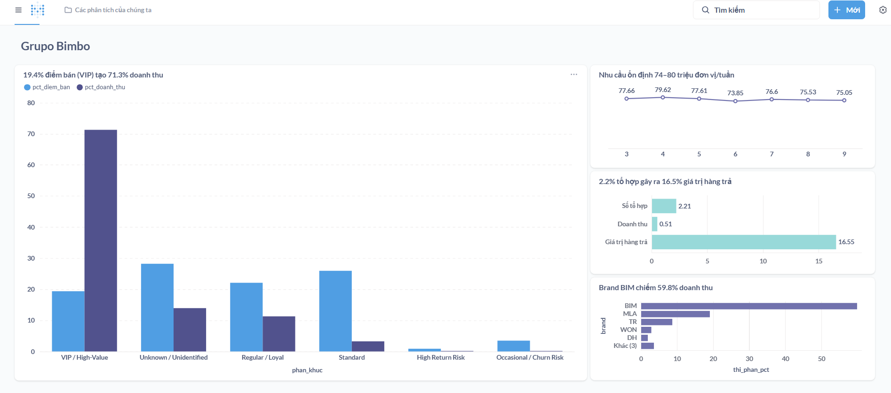
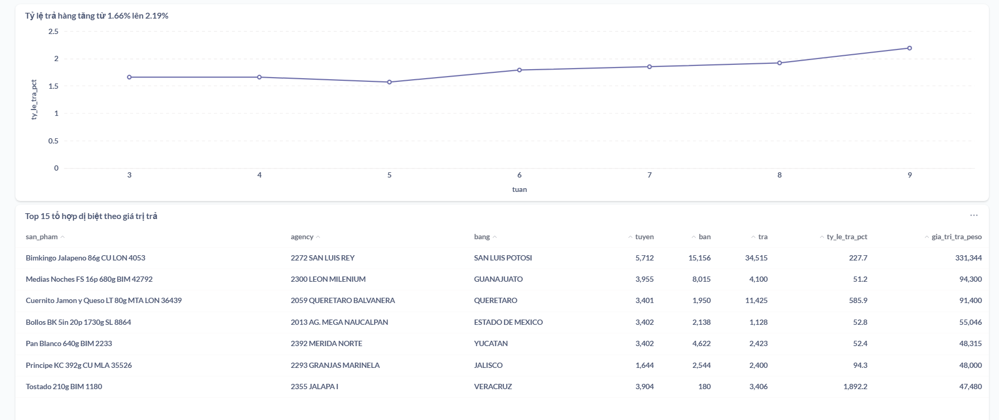
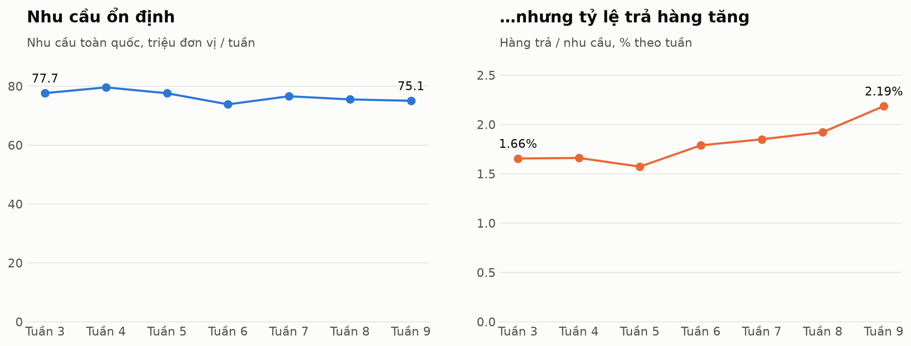
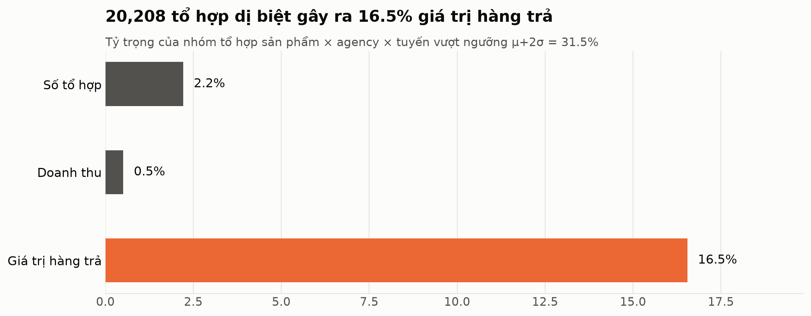
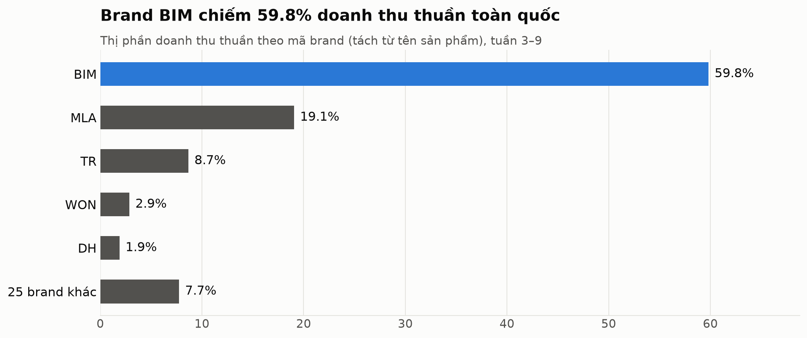
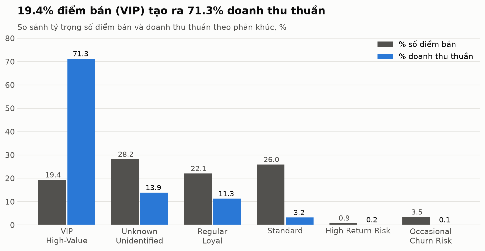

# BÁO CÁO DỰ ÁN CUỐI KỲ: BDT301
## END-TO-END BIG DATA ANALYTICS PIPELINE
### Đề tài: Tối ưu hóa Chuỗi Cung ứng và Dự báo Nhu cầu Phân phối Bánh Grupo Bimbo

---

* **Học phần:** BDT301 – Big Data Technologies
* **Trọng số:** 25%
* **Tập dữ liệu:** Grupo Bimbo Inventory Demand (~3.5 GB raw, 74.2 triệu dòng)
* **Kho lưu trữ:** `https://github.com/GiaHuy-K/BDT_Project`
* **Nhóm 3:** Khổng Trần Gia Huy · Bùi Anh Duy · Nguyễn Võ Tuấn Kiệt (phân công chi tiết: [`docs/contribution.md`](../contribution.md))

---

## 1. Giới thiệu Bài toán và Câu hỏi Nghiệp vụ (Problem & Business Questions)

### 1.1. Bối cảnh Doanh nghiệp
**Grupo Bimbo** là tập đoàn sản xuất và phân phối bánh nướng lớn nhất thế giới. Mô hình vận hành của Bimbo dựa trên chuỗi cung ứng giao hàng trực tiếp đến cửa hàng (Direct-Store Delivery - DSD) tại Mexico; riêng tập dữ liệu này có 930,500 mã điểm bán và 552 agency trong 7 tuần.

Đặc thù của sản phẩm bánh mì là **hạn sử dụng ngắn** (shelf-life ngắn). Khi sản phẩm hết hạn mà chưa bán được, tài xế giao hàng sẽ nhận lại hàng tồn ở tuần tiếp theo (`Dev_proxima`). Thách thức lớn của Bimbo là:
* Nếu cung ứng thiếu: Mất doanh thu và mất lòng tin của khách hàng.
* Nếu cung ứng thừa: Tỷ lệ hàng đổi trả cao dẫn đến chi phí tiêu hủy và hao tổn tài chính khổng lồ.

Hệ thống phân tích cũ bị chậm, phân mảnh và không thể xử lý khối lượng dữ liệu giao dịch hàng chục gigabyte theo thời gian thực. Dự án này xây dựng một **nền tảng Big Data hoàn chỉnh (End-to-End Pipeline)** nhằm thu thập, lưu trữ, xử lý phân tán với Apache Spark, và đưa ra quyết định kinh doanh dựa trên dữ liệu.

### 1.2. Bốn câu hỏi Nghiệp vụ Trọng tâm (Business Questions)

1. **Q1 (Nhu cầu theo thời gian & khu vực):** Nhu cầu tiêu thụ bánh và doanh thu thay đổi như thế nào qua từng tuần (`Semana 3–9`), theo từng bang và từng kênh phân phối? Tốc độ tăng trưởng tuần qua tuần (WoW%) là bao nhiêu?
2. **Q2 (Phát hiện dị biệt trong tỷ lệ hoàn hàng):** Những sản phẩm, đại lý (`Agencia_ID`) và tuyến giao hàng (`Ruta_SAK`) nào có tỷ lệ trả hàng cao bất thường (vượt quá ngưỡng kiểm soát $\mu + 2\sigma$)?
3. **Q3 (Xếp hạng sản phẩm & thị phần thương hiệu):** Top 10 sản phẩm bán chạy nhất và tỷ trọng doanh thu đóng góp của từng thương hiệu (`brand`) tại mỗi bang là bao nhiêu?
4. **Q4 (Phân khúc điểm bán lẻ):** Khách hàng/điểm bán lẻ được phân khúc như thế nào dựa trên tần suất mua hàng (`active_weeks`), doanh số đóng góp và rủi ro hoàn hàng để tối ưu chính sách tín dụng và chăm sóc?

---

## 2. Dữ liệu và Quy trình Ingestion (Dataset & Ingestion)

### 2.1. Nguồn và Quy mô Dữ liệu
Dự án sử dụng bộ dữ liệu chính thức từ cuộc thi Kaggle [Grupo Bimbo Inventory Demand](https://www.kaggle.com/competitions/grupo-bimbo-inventory-demand/data) với tổng dung lượng dữ liệu thô **~3.5 GB**:

| Tên tệp | Vai trò | Kích thước | Số dòng | Mô tả |
| :--- | :--- | :--- | :--- | :--- |
| `train.csv` | Fact Table | 3,199 MB | 74,180,464 | Giao dịch bán lẻ từ tuần 3 đến tuần 9 |
| `test.csv` | Fact Table | 251 MB | 6,999,251 | Dữ liệu giao hàng tuần 10–11 |
| `cliente_tabla.csv` | Dimension | 21 MB | 935,362 | Danh mục mã khách hàng và tên điểm bán |
| `producto_tabla.csv` | Dimension | 0.1 MB | 2,592 | Danh mục mã sản phẩm và mô tả tên bánh |
| `town_state.csv` | Dimension | < 0.1 MB | 790 | Danh mục đại lý phân phối, thành phố và bang |

### 2.2. Vấn đề Chất lượng Dữ liệu Thô (Data Quality Issues)
* **Khóa chính trùng lặp:** File `cliente_tabla` có 935,362 dòng nhưng chỉ 930,500 `Cliente_ID` khác nhau, tức 4,862 dòng trùng ID, thường là biến thể viết hoa/thường hoặc khoảng trắng của cùng một tên.
* **Dữ liệu thiếu định danh:** sau dedup còn 282,025 khách hàng có tên `"SIN NOMBRE"` hoặc `"NO IDENTIFICADO"`, chiếm 13,259,253 dòng giao dịch (17.9% bảng fact).
* **Cấu trúc trường phi chuẩn:** Tên sản phẩm trong `producto_tabla` gộp chung cả tên bánh, số lượng đóng gói (`pieces`), trọng lượng (`weight_g`), và mã thương hiệu (`brand`).
* **Ký tự đặc biệt & Encoding:** Tên bang và địa danh chứa chữ có dấu tiếng Tây Ban Nha (`Á, É, Í, Ó, Ú, Ñ`), gây lỗi font chữ nếu đọc ở chuẩn mã hóa thông thường.
* **Phân phối lệch (Skewness):** Nhu cầu hàng hóa dao động lớn (trung bình 7.2 cái, giá trị lớn nhất lên đến 5,000 cái); kênh phân phối số 1 chiếm hơn 91% tổng số lượng bản ghi.

### 2.3. Thiết kế Ingestion Tự động & Lặp lại (Repeatable Ingestion)
Quy trình nạp dữ liệu được tự động hóa qua script `ingestion/ingest.py`:
1. Nếu `data/` chưa có file zip, tự tải về bằng Kaggle API (`kaggle competitions download`).
2. Đọc luồng các CSV trong zip lồng nhau và đẩy trực tiếp lên **MinIO bucket `raw/`** mà không giải nén trung gian ra ổ đĩa cục bộ.
3. Tính **SHA-256** trong lúc stream và lưu vào metadata của object. Lần chạy sau, file có cùng SHA-256 sẽ được bỏ qua (idempotency); file khác checksum thì dừng và yêu cầu chạy lại với `--force`.
4. Ghi nhận nhật ký nạp trong file manifest `ingest_<timestamp>.json` phục vụ truy xuất nguồn gốc (lineage tracking).

---

## 3. Thiết kế Kiến trúc và Tầng Lưu trữ (Architecture & Storage)

### 3.1. Medallion Architecture
Hệ thống áp dụng kiến trúc dữ liệu chuẩn công nghiệp gồm các tầng tách biệt:

1. **Raw Storage (MinIO `s3a://raw`):** Lưu trữ file CSV gốc nguyên bản. Pipeline chỉ đọc từ bucket này, mọi kết quả Spark đều ghi sang bucket `processed`. (Chưa bật Object Lock của MinIO, xem mục 7.)
2. **Bronze Layer (`s3a://processed/bronze`):** Chuyển đổi toàn bộ CSV thành định dạng nén cột **Apache Parquet**, áp dụng schema tĩnh tường minh (`StructType`), bổ sung trường audit (`_source_file`, `_ingested_at`), và phân vùng theo tuần giao dịch (`partitionBy("Semana")`). Đo trên MinIO: `train` giảm từ 3,199 MB (CSV) xuống 515 MB (Parquet Snappy), nhỏ hơn khoảng 6.2 lần.
3. **Silver Layer (`s3a://processed/silver`):** 
   - Làm sạch, khử trùng lặp dimension.
   - Trích xuất đặc trưng sản phẩm bằng Regular Expression (tách số cái, số gram, tên thương hiệu).
   - Chuẩn hóa tên bang địa lý.
   - Thực hiện Broadcast Join giữa bảng Fact và 3 bảng Dimension.
   - Phân loại dữ liệu không hợp lệ vào bảng `rejected` kèm lý do.
   - Thiết lập kiểm tra bất biến dữ liệu: `fact_sales + rejected == bronze_train`.
4. **Gold Layer (`s3a://processed/gold`):** Tổng hợp dữ liệu đa chiều (denormalized aggregates) thành 4 bảng phục vụ trực tiếp cho 4 câu hỏi nghiệp vụ Q1–Q4.
5. **Serving Layer (PostgreSQL 16):** Job `export_postgres.py` ghi đè (overwrite + truncate) 4 bảng Gold vào schema `gold` qua JDBC. Hiện chưa tạo index; với kích thước bảng Gold hiện tại thì chưa cần (xem mục 6.2).
6. **Presentation Layer (Metabase):** Kết nối trực tiếp vào PostgreSQL, cung cấp bảng điều khiển trực quan (BI dashboard) cho các nhà quản lý chuỗi cung ứng.

---

## 4. Xử lý Dữ liệu với Apache Spark (Spark Processing)

### 4.1. Cấu hình Cụm Phân tán (Distributed Spark Cluster)
Cụm Spark 3.5.3 được vận hành trong mạng Docker với:
* **Spark Master:** Điều phối tài nguyên và quản lý đồ thị tính toán (DAG).
* **2 Spark Workers:** Mỗi worker có 2 CPU cores và 2 GB RAM (`SPARK_WORKER_MEMORY`); mỗi executor dùng 1.5 GB (`spark.executor.memory = 1536m`). Bật Adaptive Query Execution và skew join.
* **Spark History Server:** Ghi nhận toàn bộ event log tính toán tại cổng `18080` làm bằng chứng thực thi độc lập.
* **Gói tích hợp phụ thuộc:** `hadoop-aws:3.3.4`, `aws-java-sdk-bundle:1.12.262`, và `postgresql:42.7.4`.

### 4.2. Các biến đổi quan trọng (Transformations)
1. **Trích xuất thông tin sản phẩm (Regex Parsing):**
   ```python
   # spark_jobs/silver.py – ví dụ "Bimbollos Ext sAjonjoli 6p 480g BIM 41" -> 6 cái, 480 g, brand BIM
   weight_val  = F.regexp_extract(name, r"(?i)\b(\d+(?:\.\d+)?)\s?(kg|g|ml)\b", 1)
   weight_unit = F.lower(F.regexp_extract(name, r"(?i)\b(\d+(?:\.\d+)?)\s?(kg|g|ml)\b", 2))
   pieces      = F.regexp_extract(name, r"(?i)\b(\d+)p\b", 1)
   brand       = F.regexp_extract(name, r"\s(\S+)\s+\d+\s*$", 1)   # token ngay trước Producto_ID cuối tên
   ```
   Kết quả trên 2,592 sản phẩm: 2,528 tách được trọng lượng (kg được đổi sang gram), 1,124 tách được số cái, 2,591 có brand (45 mã brand khác nhau, ví dụ `BIM`, `MLA`, `TR`).
2. **Khử trùng lặp và điền khuyết khách hàng:**
   Nhóm khách hàng vô danh được gán cờ `is_unknown_client`, tên được chuẩn hóa về `"UNKNOWN"`.
3. **Phát hiện dị biệt thống kê ở Gold (Anomaly Detection với 2-Sigma):**
   Gom nhóm theo tổ hợp **sản phẩm × agency × tuyến (`Ruta_SAK`)**, tính `return_rate = Dev_uni_proxima / Venta_uni_hoy`. Giá trị trung bình ($\mu$) và độ lệch chuẩn ($\sigma$) chỉ tính trên các tổ hợp bán ≥ 20 đơn vị để tránh nhiễu từ tổ hợp quá nhỏ:
   $$\text{Threshold} = \mu_{\text{return\_rate}} + 2 \cdot \sigma_{\text{return\_rate}}$$
   Tổ hợp có `sales_units ≥ 20` và tỷ lệ trả vượt ngưỡng được đánh dấu `is_anomaly = True`.
4. **Phân khúc khách hàng theo hành vi (RFM Rule-Based Segmentation):**
   Dựa trên 7 tuần giao dịch, hệ thống tính số tuần hoạt động (`active_weeks`), doanh thu thuần (`net_revenue = Venta_hoy − Dev_proxima`) và tỷ lệ trả hàng của mỗi khách hàng, rồi gán nhóm theo thứ tự ưu tiên (điều kiện đầu tiên đúng sẽ được chọn):
   1. *Unknown / Unidentified*: khách hàng không định danh (`is_unknown_client`).
   2. *VIP / High-Value*: `net_revenue` ≥ 10,000 pesos, hoặc `active_weeks` ≥ 5 và `net_revenue` ≥ 5,000.
   3. *High Return Risk*: tỷ lệ trả ≥ 15% và trả ≥ 20 đơn vị.
   4. *Regular / Loyal*: `active_weeks` ≥ 4 và `net_revenue` ≥ 1,500.
   5. *Occasional / Churn Risk*: `active_weeks` ≤ 2.
   6. *Standard*: các khách hàng còn lại.

---

## 5. Kết quả Phân tích & Giá trị Nghiệp vụ (Analytical Results & Insights)

Mọi số liệu dưới đây lấy từ 4 bảng `gold.*` trong PostgreSQL, sinh từ lần chạy pipeline đầy đủ ngày 29/10/2026 (log: `logs/evidence/run_20261029_205823.log`, Spark application `app-20261029140355-0002` cho Gold). Có thể chạy lại các query trong `sql/analysis/` để kiểm tra.

| Bảng Gold | Số dòng | Câu hỏi |
| :--- | ---: | :--- |
| `weekly_demand_by_state_channel` | 1,393 | Q1 |
| `return_rate_by_product_agency_route` | 1,062,353 | Q2 |
| `product_ranking_by_state` | 17,604 | Q3 |
| `client_segments` | 880,604 | Q4 |

Các biểu đồ trong mục này được vẽ trực tiếp từ các bảng `gold.*` bằng script [`make_figures.py`](make_figures.py) (chạy lại: `python docs/report/make_figures.py`). Dashboard Metabase dùng cùng các bảng này.

Dashboard Metabase `Grupo Bimbo` đọc trực tiếp schema `gold` trong PostgreSQL. Câu SQL của từng thẻ nằm trong [`dashboard/cards.sql`](../../dashboard/cards.sql).

**Tab "Tổng quan Q1–Q4":** thẻ lớn bên trái là Q4 (tỷ trọng số điểm bán so với doanh thu theo phân khúc); bên phải là Q1 (nhu cầu theo tuần), Q2 (tỷ trọng của nhóm tổ hợp dị biệt) và Q3 (thị phần brand).



**Tab "Chi tiết":** tỷ lệ trả hàng theo tuần (Q1) và bảng 15 tổ hợp dị biệt có giá trị trả lớn nhất (Q2).



### 5.1. Kết quả Q1: Xu hướng Nhu cầu và Doanh thu qua các Tuần

| Tuần | Nhu cầu (triệu đơn vị) | Doanh thu (triệu peso) | Hàng trả (triệu đơn vị) | Trả / nhu cầu |
| :---: | ---: | ---: | ---: | ---: |
| 3 | 77.66 | 748.6 | 1.29 | 1.66% |
| 4 | 79.62 | 755.6 | 1.32 | 1.66% |
| 5 | 77.61 | 727.9 | 1.22 | 1.57% |
| 6 | 73.85 | 701.5 | 1.32 | 1.79% |
| 7 | 76.60 | 721.7 | 1.42 | 1.85% |
| 8 | 75.53 | 713.4 | 1.45 | 1.92% |
| 9 | 75.05 | 716.0 | 1.64 | 2.19% |



* **Phát hiện:**
  * Nhu cầu toàn quốc ổn định trong khoảng 73.9–79.6 triệu đơn vị/tuần. Tuần 9 thấp hơn tuần 3 khoảng 3.4%, nhưng lượng hàng trả lại tăng 27.6% (1.29 → 1.64 triệu đơn vị), làm tỷ lệ trả/nhu cầu tăng từ 1.66% lên 2.19%.
  * Kênh 1 chiếm 91% số dòng giao dịch nhưng chỉ 72.2% nhu cầu và 61.8% doanh thu. Kênh 2 chỉ có 9.6% nhu cầu nhưng mang về 18.5% doanh thu, nên giá trị mỗi đơn vị cao hơn hẳn. Kênh 5 và kênh 8 có tỷ lệ trả theo giá trị cao nhất (5.3% và 4.2%, so với mức chung 1.8%).
  * Doanh thu tập trung ở vùng thủ đô: Estado de México (13.6%) và Ciudad de México / D.F. (12.6%), tiếp theo là Jalisco (8.5%) và Nuevo León (5.6%), trên tổng 32 bang.
* **Khuyến nghị:** Theo dõi xu hướng hàng trả tăng dần từ tuần 6 trước khi tăng sản lượng. Ưu tiên rà soát lượng giao cho kênh 5 và kênh 8. Lưu ý: dataset không công bố tên các kênh, nên nhóm chỉ so sánh theo mã `Canal_ID`.

### 5.2. Kết quả Q2: Tổ hợp Sản phẩm × Agency × Tuyến có Tỷ lệ Trả hàng Dị biệt



* **Phát hiện:**
  * Tỷ lệ trả chung trên toàn bộ tổ hợp là 1.70% theo đơn vị. Trong 913,039 tổ hợp bán ≥ 20 đơn vị, ngưỡng $\mu + 2\sigma$ là **31.52%**.
  * Có **20,208 tổ hợp dị biệt** (2.21% số tổ hợp đủ điều kiện). Nhóm này chỉ tạo ra 0.51% doanh thu nhưng chiếm **16.55% tổng giá trị hàng trả**, tức một nhóm nhỏ gây ra phần lớn tổn thất.
  * Theo brand, BIM (8,034 tổ hợp), MLA (5,514) và TR (4,066) dẫn đầu về số tổ hợp dị biệt, vì đây cũng là các brand có nhiều tổ hợp nhất. Tính theo tỷ lệ trả, RIC (7.5%), BAR (4.6%) và LON (3.2%) cao hơn hẳn mức chung.
  * Tổ hợp tổn thất lớn nhất: *Bimkingo Jalapeño 86g* tại agency 1345 (San Luis Potosí), tuyến 5712 bán 15,156 đơn vị nhưng nhận trả 34,515 đơn vị, trị giá 331,344 peso.
  * Một số tổ hợp có tỷ lệ trả > 100%, vì `Dev_uni_proxima` là hàng trả từ các lần giao trước. Silver giữ lại các dòng này và gắn cờ `returns_exceed_sales` (615,828 dòng) thay vì xóa.
* **Khuyến nghị:** Ưu tiên rà soát 20,208 tổ hợp dị biệt, bắt đầu từ các tổ hợp có `return_pesos` lớn nhất. Giảm lượng giao ban đầu hoặc chuyển sang giao bổ sung tại các tuyến này. Đây là nhóm nhỏ nhưng tác động lớn tới chi phí hàng trả.

### 5.3. Kết quả Q3: Xếp hạng Sản phẩm và Thị phần Thương hiệu theo Bang



* **Phát hiện:**
  * *Pan Blanco 640g* (`Producto_ID` 2233) nằm trong top 3 doanh thu ở **25/32 bang** và đứng hạng 1 ở 11 bang. Các phiên bản *Nito 1p 62g* (2425, 1278, 43206) đứng hạng 1 ở tổng cộng 15 bang.
  * Theo doanh thu thuần toàn quốc, brand BIM chiếm **59.8%**, MLA 19.1% và TR 8.7%. Ba brand này chiếm gần 88% tổng doanh thu.
  * Mức độ tập trung khác nhau giữa các bang: top 10 sản phẩm chiếm từ 17.8% đến 39.3% doanh thu của bang, trung bình 30.4%.
* **Khuyến nghị:** Đảm bảo tồn kho ổn định cho nhóm sản phẩm chủ lực (Pan Blanco, Nito) ở mọi bang. Với các bang mà top 10 chỉ chiếm dưới 20% doanh thu, danh mục sản phẩm phân tán hơn, nên phân bổ sản phẩm theo dữ liệu từng bang thay vì dùng chung một danh mục.

### 5.4. Kết quả Q4: Phân khúc Khách hàng Điểm bán

| Phân khúc | Số điểm bán | % điểm bán | % doanh thu thuần | Tỷ lệ trả (theo peso) |
| :--- | ---: | ---: | ---: | ---: |
| VIP / High-Value | 170,517 | 19.4% | 71.3% | 1.56% |
| Unknown / Unidentified | 248,436 | 28.2% | 13.9% | 1.89% |
| Regular / Loyal | 194,654 | 22.1% | 11.3% | 1.98% |
| Standard | 228,584 | 26.0% | 3.2% | 2.65% |
| High Return Risk | 7,834 | 0.9% | 0.2% | 45.84% |
| Occasional / Churn Risk | 30,579 | 3.5% | 0.1% | 1.86% |



* **Phát hiện:**
  * Nhóm VIP chiếm 19.4% số điểm bán nhưng mang về **71.3% doanh thu thuần**. Riêng 1% điểm bán lớn nhất đã chiếm 33.2% doanh thu.
  * Nhóm High Return Risk nhỏ (7,834 điểm bán), nhưng cứ 100 peso hàng bán thì có 45.8 peso bị trả lại, gấp khoảng 25 lần mức chung 1.81%.
  * 28.2% điểm bán không định danh được ("SIN NOMBRE" / "NO IDENTIFICADO") nhưng vẫn tạo ra 13.9% doanh thu. Đây là khoảng trống dữ liệu khách hàng cần bổ sung.
* **Khuyến nghị:** Ưu tiên lịch giao và chính sách chăm sóc cho nhóm VIP. Với nhóm High Return Risk, giới hạn lượng giao hoặc điều chỉnh chính sách đổi trả. Bổ sung thông tin cho nhóm điểm bán không định danh để phân khúc chính xác hơn.

---

## 6. Độ tin cậy, Rủi ro Thất bại & Đánh đổi Kiến trúc (Reliability & Trade-offs)

### 6.1. Nhận diện Rủi ro Thất bại và Giải pháp
1. **Rủi ro Memory OOM (Out Of Memory) trong Spark:**
   - *Nguyên nhân:* Xử lý 74 triệu bản ghi trên cụm Docker với RAM hạn chế (1.5 GB mỗi executor) dễ tràn bộ nhớ khi join hoặc shuffle dữ liệu lớn, nhất là các phép `groupBy` của Gold trên toàn bộ bảng fact.
   - *Giải pháp:* Áp dụng triệt để cơ chế **Broadcast Join** cho các bảng dimension kích thước nhỏ; phân vùng Parquet theo `Semana` để Spark chỉ nạp đúng partition cần tính toán; tránh sử dụng `.cache()` toàn bộ dữ liệu 74 triệu dòng vào RAM khi không cần thiết.
2. **Rủi ro Dị biệt Dữ liệu (Data Corruption & Incomplete Ingestion):**
   - *Nguyên nhân:* Kết nối mạng gián đoạn khi nạp dữ liệu từ Kaggle có thể gây hỏng file CSV thô.
   - *Giải pháp:* Thiết lập cơ chế kiểm tra **SHA-256 checksum** và manifest (số byte, số dòng của từng file) tại tầng Ingestion và chốt chặn **Invariant Check** ở Silver: nếu số lượng dòng `fact_sales + rejected != bronze_train`, toàn bộ tiến trình sẽ báo lỗi và dừng thực thi (fail-fast), ngăn chặn dữ liệu bẩn tràn vào kho báo cáo.

### 6.2. Phân tích Đánh đổi Kiến trúc (Trade-offs)
* **Batch Processing vs. Real-time Streaming:** Chu kỳ phân phối của Grupo Bimbo được hoạch định theo ngày và tuần. Dữ liệu đến theo tuần và hàng trả lại chỉ được ghi nhận ở chu kỳ giao sau (`Dev_proxima`), nên batch là đủ: cụm Spark chỉ cần chạy khi có dữ liệu mới, không phải duy trì Kafka + Spark Streaming 24/7. Đổi lại, kết quả có độ trễ bằng một lần chạy pipeline (7 phút 16 giây cho toàn bộ pipeline, từ ingest đến export, trong lần chạy làm bằng chứng).
* **Normalized vs. Denormalized Storage:** Tầng Silver duy trì chuẩn hóa Star Schema để tối ưu dung lượng lưu trữ Parquet; tầng Gold làm phẳng (denormalize) thành các bảng tổng hợp để đưa sang PostgreSQL. Dashboard chỉ đọc 1.96 triệu dòng Gold thay vì join 74.2 triệu dòng fact. Đổi lại, dữ liệu bị lặp (tên sản phẩm, bang nằm sẵn trong từng bảng) và phải chạy lại Gold khi dimension thay đổi.

---

## 7. Đánh giá Hạn chế và Hướng Phát triển (Limitations & Future Work)
* **Hạn chế:**
  * Pipeline được điều phối bằng `run.sh`: chưa có giao diện giám sát DAG và chưa tự thử lại (retry) khi một bước lỗi; chỉ chạy lại thủ công từ bước lỗi, ví dụ `./run.sh gold`.
  * Bucket `raw` chưa bật Object Lock, nên tính bất biến của dữ liệu gốc mới dựa trên quy ước "chỉ đọc" của pipeline.
  * Dataset không mô tả ý nghĩa `Canal_ID` và không có ngày cụ thể (chỉ có số tuần), nên phân tích theo kênh chỉ so sánh được theo mã kênh.
  * Ngưỡng phân khúc Q4 và ngưỡng 2σ ở Q2 là quy tắc do nhóm tự đặt, chưa được kiểm chứng với nghiệp vụ thực tế.
* **Hướng phát triển:** 
  1. Triển khai **Apache Airflow** để điều phối và lập lịch pipeline tự động.
  2. Nâng cấp định dạng lưu trữ sang **Delta Lake** hoặc **Apache Iceberg** để hỗ trợ giao dịch ACID và Time-Travel.
  3. Xây dựng mô hình Machine Learning dự báo nhu cầu chính xác cho tuần 10–11 sử dụng thư viện **Spark MLlib** (ví dụ: GBDT / Random Forest Regressor).

---

## 8. Kết luận
Dự án đã xây dựng thành công một pipeline phân tích dữ liệu lớn hoàn chỉnh (End-to-End Big Data Analytics Pipeline), xử lý thành công toàn bộ **74.2 triệu bản ghi (~3.5 GB)** dữ liệu phân phối của tập đoàn Grupo Bimbo. Kiểm tra bất biến `fact_sales + rejected = bronze_train` đạt trên toàn bộ dữ liệu, và 4 bảng Gold trả lời Q1–Q4 đều được sinh từ cùng một lần chạy có log làm bằng chứng (`logs/evidence/`). Các hạn chế ở mục 7 là hướng cải tiến tiếp theo.

